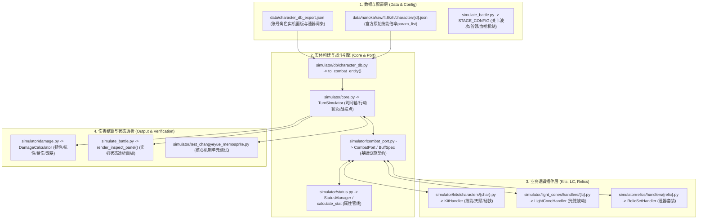

# 星穹铁道伤害计算与战斗模拟器代码索引与架构速查表 (CODEBASE INDEX)

> 本文档用于在研发、重构与排障时**秒级精确定位**目标代码、数据与测试用例，杜绝盲目搜索。

---

## 一、 核心架构调用链路与分层图谱



---

## 二、 场景化极速定位速查表 (Task-to-File Matrix)

| 研发/调试目标 | 精确文件路径 | 核心类 / 函数 / 字段 | 关键注意事项 |
| :--- | :--- | :--- | :--- |
| **修改角色技能 / 天赋 / 秘技** | `simulator/kits/characters/<char_pinyin>.py` | `KitHandler.execute()`<br>`KitHandler.use_technique()`<br>`KitHandler.on_battle_start()` | **严禁硬编码！** 动态加成必须通过 `self.port.stat()` 采样本体属性，乘以 `self.skill_param()` 动态倍率。 |
| **修改伴生忆灵「长夜」机制** | `simulator/kits/characters/changyeyue.py` | `summon_spirit()`<br>`get_memosprite_snapshot()`<br>`calc_skill_shared_crit_dmg()` | 忆灵快照中必须过滤角色专属标记；暴伤必须动态采样长夜月本体并排除自循环加成。 |
| **修改缇宝结界 / 天赋追击** | `simulator/kits/characters/tibao.py` | `TibaoKit.on_battle_start()`<br>`apply_divine_revelation()` | 【好忙好忙的缇宝】严禁下发给忆灵；E4【心意相契的安宁】在结界生效时提供 18% 无视防御。 |
| **修改专属光锥机制 (如冥花)** | `simulator/light_cones/handlers/make_farewells_more_beautiful.py` | `trigger_flower_buff()`<br>`on_action_after()` | 自身或忆灵扣血时插入 `LC_Farewells_FlowerBuff`，提供 30% 无视防御。 |
| **修改知更鸟晴歌 / 氛围值** | `simulator/kits/characters/robin_sunnysong.py` | `RobinSunnySongKit.add_vibes()`<br>`RobinSunnySongKit.on_action_after()` | 开局氛围值 = 风堇(1) + 晴歌(6) + 长夜(1) = 8 点；暴伤 = 40 + 1.5 * vibes = 52.0%。 |
| **修改遗器套装效果 (如女武神)** | `simulator/relics/handlers/valkyrie_of_sun_and_thunder.py` | `apply_panel_passives()`<br>`on_battle_start()` | 挂载【烈阳惊雷的女武神 / 甘霖】全队暴伤 +15%。 |
| **修改关卡波次与环境机制** | `simulate_battle.py` | `STAGE_CONFIG["mechanics"]`<br>`STAGE_CONFIG["waves"]` | 关卡全局环境机制（如 `["血嗜"]`）在 `TurnSimulator.__init__` 中挂载为 `category="other"`。 |
| **修改实时状态透析面板输出** | `simulate_battle.py` | `render_inspect_panel()` | 格式化打印角色与伴生忆灵面板，遵循星铁实机面板标准，直接读取 `msnap` 快照。 |
| **查阅官方 4.6 技能参数与倍率** | `data/nanoka/raw/4.6/zh/character/{id}.json` | `skills -> {skill_id} -> level -> param_list` | 官方原始基准源文件（长夜月: 1413, 晴歌: 1512, 缇宝: 1403, 风堇: 1410）。 |
| **运行与核对核心单元测试** | `simulator/test_changyeyue_memosprite.py`<br>`simulator/test_tibao_verification.py` | `TestChangyeyueMemospriteMechanics`<br>`TestTibaoVerification` | 必须维持 8/8 100% 通过率。 |

---

## 三、 常用角色技能套件文件映射表 (Character Kit Registry)

角色注册中心位于：[`simulator/kits/registry.py`](file:///d:/Downloads/星穹铁道伤害计算软件v1.02/simulator/kits/registry.py)

| 角色名 (中文) | 英文/别名 | Avatar ID | 源码文件路径 | 核心机制类名 |
| :--- | :--- | :--- | :--- | :--- |
| **长夜月** | Evernight | **1413** | `simulator/kits/characters/changyeyue.py` | `ChangyeyueKit` / `ChangyeMemospriteKit` |
| **缇宝** | Tribbie | **1403** | `simulator/kits/characters/tibao.py` | `TibaoKit` |
| **知更鸟•晴歌** | Robin SunnySong | **1512** | `simulator/kits/characters/robin_sunnysong.py` | `RobinSunnySongKit` |
| **风堇** | Fengjin | **1410** | `simulator/kits/characters/fengjin.py` | `FengjinKit` |
| **知更鸟 (原版)** | Robin | **1309** | `simulator/kits/characters/robin.py` | `RobinKit` |
| **星期日** | Sunday | **1313** | `simulator/kits/characters/sunday.py` | `SundayKit` |
| **花火** | Sparkle | **1306** | `simulator/kits/characters/sparkle.py` | `SparkleKit` |
| **阮•梅** | Ruan Mei | **1303** | `simulator/kits/characters/ruan_mei.py` | `RuanMeiKit` |
| **黄泉** | Acheron | **1308** | `simulator/kits/characters/acheron.py` | `AcheronKit` |
| **流萤** | Firefly | **1310** | `simulator/kits/characters/firefly.py` | `FireflyKit` |
| **砂金** | Aventurine | **1304** | `simulator/kits/characters/aventurine.py` | `AventurineKit` |
| **符玄** | Fu Xuan | **1208** | `simulator/kits/characters/fuxuan.py` | `FuXuanKit` |

---

## 四、 核心光锥与遗器文件映射表

### 1. 光锥 (Light Cones)
注册中心：[`simulator/light_cones/catalog.py`](file:///d:/Downloads/星穹铁道伤害计算软件v1.02/simulator/light_cones/catalog.py)
* **《让告别，更美一些》** (长夜月专属 ID 23040): [`simulator/light_cones/handlers/make_farewells_more_beautiful.py`](file:///d:/Downloads/星穹铁道伤害计算软件v1.02/simulator/light_cones/handlers/make_farewells_more_beautiful.py)
* **《若时间是一朵花》** (知更鸟专属 ID 23024): [`simulator/light_cones/handlers/if_time_were_a_flower.py`](file:///d:/Downloads/星穹铁道伤害计算软件v1.02/simulator/light_cones/handlers/if_time_were_a_flower.py)
* **《愿彩虹留于苍穹》** (缇宝专属 ID 23035): [`simulator/light_cones/handlers/may_rainbows_remain_in_the_sky.py`](file:///d:/Downloads/星穹铁道伤害计算软件v1.02/simulator/light_cones/handlers/may_rainbows_remain_in_the_sky.py)
* **《记忆永不褪色》**: [`simulator/light_cones/handlers/memory_never_fades.py`](file:///d:/Downloads/星穹铁道伤害计算软件v1.02/simulator/light_cones/handlers/memory_never_fades.py)

### 2. 遗器 (Relic Sets)
注册中心：[`simulator/relics/catalog.py`](file:///d:/Downloads/星穹铁道伤害计算软件v1.02/simulator/relics/catalog.py)
* **烈阳与惊雷的女武神** (ID 124): [`simulator/relics/handlers/valkyrie_of_sun_and_thunder.py`](file:///d:/Downloads/星穹铁道伤害计算软件v1.02/simulator/relics/handlers/valkyrie_of_sun_and_thunder.py)
* **谧宁拾骨地** (ID 319): [`simulator/relics/handlers/bone_collecting_ground.py`](file:///d:/Downloads/星穹铁道伤害计算软件v1.02/simulator/relics/handlers/bone_collecting_ground.py)
* **沉没的母树** (ID 320): [`simulator/relics/handlers/sunken_tree.py`](file:///d:/Downloads/星穹铁道伤害计算软件v1.02/simulator/relics/handlers/sunken_tree.py)
* **哀歌覆国的诗人** (ID 128): [`simulator/relics/handlers/poet_of_mourning.py`](file:///d:/Downloads/星穹铁道伤害计算软件v1.02/simulator/relics/handlers/poet_of_mourning.py)

---

## 五、 核心设计守则 (Strict Zero-Hardcoding Mandates)

1. **绝对禁止硬编码任何技能/光锥/遗器加成数值**：
   - 错误写法示例：`modifiers=(Modifier(StatType.CRIT_DMG, ModifierOp.ADD, 1.08),)`
   - 正确写法示例：
     ```python
     cd_ratio = self.skill_param("skill", 0, default=0.24)
     owner_cd = self.get_owner_crit_dmg()
     shared_cd = round(owner_cd * cd_ratio, 4)
     modifiers=(Modifier(StatType.CRIT_DMG, ModifierOp.ADD, shared_cd),)
     ```
2. **状态插件化挂载原则**：
   - 所有的增益（Buff）、负面（Debuff）以及机制标记（Other），必须通过 `self.port.upsert_status(BuffSpec(...))` 作为独立的 `StatusInstance` 插件插入到 `status_mgr` 中。
   - 严禁在快照方法（如 `get_memosprite_snapshot`）中使用手动的字典 `.append()` 追加伪数据。
3. **实体隔离原则**：
   - 角色专属的动作标记（如【好忙好忙的缇宝】）严禁挂载给伴生忆灵；
   - 忆灵专属的暴伤加成（如【白昼悄然离去】、【天亮了，雨落了】）必须定向作用于忆灵，严禁反向污染长夜月本体的面板计算。
4. **双仓库同步原则**：
   - 工作目录修改完成后，必须立即通过 `scratch/sync_repo.py` 将核心源码、测试用例和文档镜像同步至 `d:\Downloads\StarRail-Combat-Simulator` 并完成 Git Commit & Push。
