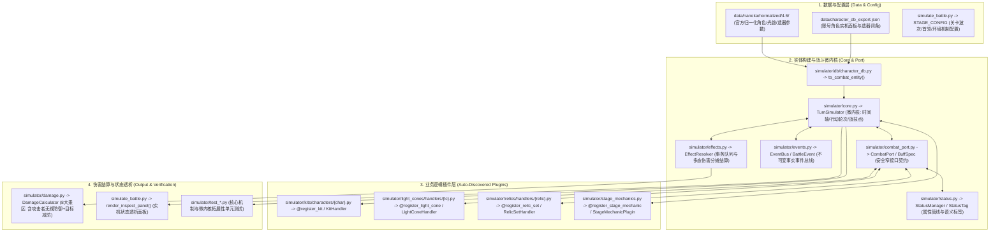

# 星穹铁道伤害计算与战斗模拟器代码索引与架构速查表 (CODEBASE INDEX)

> 📘 **新手开发指南与 SOP 规范**：全套公式化开发流程、扩展钩子总表与红线禁令，请查阅 [DEVELOPER_GUIDE.md](file:///Users/yunkaichen/Downloads/starrail/DEVELOPER_GUIDE.md)。  
> 本文档用于在研发、重构与排障时**秒级精确定位**目标代码、脚手架模板、数据与测试用例。

---

## 一、 核心架构调用链路与分层图谱

---

## 二、 场景化极速定位速查表 (Task-to-File Matrix)

| 研发/调试目标 | 精确文件路径 | 核心类 / 装饰器 / 钩子 | 关键注意事项 |
| :--- | :--- | :--- | :--- |
| **新建角色 / 伴生忆灵套件** | [`simulator/kits/characters/_template.py`](file:///Users/yunkaichen/Downloads/starrail/simulator/kits/characters/_template.py) | `@register_kit` `KitHandler.definition()` `KitHandler.execute()` | 复制 `_template.py` 并加上 `@register_kit` 即可自动扫描注册，严禁访问 `port.sim` 或 `port._get_entity`。 |
| **新建专属光锥处理器** | [`simulator/light_cones/handlers/_template.py`](file:///Users/yunkaichen/Downloads/starrail/simulator/light_cones/handlers/_template.py) | `@register_light_cone` `LightConeHandler.scale()` `LightConeHandler.on_event()` | 复制 `_template.py` 并加上 `@register_light_cone`，通过监听 `HPLostEvent` / `SpiritDespawnEvent` 等事件解耦触发。 |
| **新建遗器套装处理器** | [`simulator/relics/handlers/_template.py`](file:///Users/yunkaichen/Downloads/starrail/simulator/relics/handlers/_template.py) | `@register_relic_set` `RelicSetHandler.on_battle_start()` | 复制 `_template.py` 并加上 `@register_relic_set`，自动扫描注册。 |
| **修改伴生忆灵机制 (长夜月)** | [`simulator/kits/characters/changyeyue.py`](file:///Users/yunkaichen/Downloads/starrail/simulator/kits/characters/changyeyue.py) | `summon_spirit()` `get_memosprite_snapshot()` `calc_skill_shared_crit_dmg()` | 忆灵专属加成必须打上 `StatusTag.MEMOSPRITE_ONLY` 与 `EXCLUDE_FROM_STAT_TRANSFERS` 标签，防自循环。 |
| **修改伤害分摊/减免 (符玄)** | [`simulator/kits/characters/fuxuan.py`](file:///Users/yunkaichen/Downloads/starrail/simulator/kits/characters/fuxuan.py) | `FuXuanKit.intercept_incoming_damage()` `FuXuanKit.on_hp_lost()` | 通过 `KitHandler.intercept_incoming_damage` 多态协议拦截分摊伤害，`effects.py` 零角色名硬编码。 |
| **修改缇宝结界 / 天赋追击** | [`simulator/kits/characters/tibao.py`](file:///Users/yunkaichen/Downloads/starrail/simulator/kits/characters/tibao.py) | `TibaoKit.on_battle_start()` `apply_divine_revelation()` | 【好忙好忙的缇宝】打上 `StatusTag.CHARACTER_ONLY` 标签，严禁下发或投影给忆灵。 |
| **修改专属光锥机制 (如冥花)** | [`simulator/light_cones/handlers/make_farewells_more_beautiful.py`](file:///Users/yunkaichen/Downloads/starrail/simulator/light_cones/handlers/make_farewells_more_beautiful.py) | `trigger_flower_buff()` `on_event(HPLostEvent)` | 监听标准 `HPLostEvent` 与 `SpiritDespawnEvent`，提供 30%~50% 无视防御 (`StatType.DEF_SHRED`)。 |
| **修改知更鸟晴歌 / 气氛值** | [`simulator/kits/characters/robin_sunnysong.py`](file:///Users/yunkaichen/Downloads/starrail/simulator/kits/characters/robin_sunnysong.py) | `RobinSunnySongKit.gain_vibes()` `RobinSunnySongKit.on_event()` | 监听标准 `HealAppliedEvent` 与 `ActionExecuteEvent`。 |
| **修改关卡波次与环境机制** | [`simulator/stage_mechanics.py`](file:///Users/yunkaichen/Downloads/starrail/simulator/stage_mechanics.py) [`simulate_battle.py`](file:///Users/yunkaichen/Downloads/starrail/simulate_battle.py) | `@register_stage_mechanic` `StageMechanicRegistry` | 关卡全局环境机制通过 `StageMechanicPlugin` 插件驱动，支持中英文换名即插即用。 |
| **运行全套单元测试与架构验证** | [`simulator/test_changyeyue_memosprite.py`](file:///Users/yunkaichen/Downloads/starrail/simulator/test_changyeyue_memosprite.py) [`simulator/test_tibao_verification.py`](file:///Users/yunkaichen/Downloads/starrail/simulator/test_tibao_verification.py) [`simulator/test_changyeyue_team_synergy.py`](file:///Users/yunkaichen/Downloads/starrail/simulator/test_changyeyue_team_synergy.py) [`simulator/test_framework_extensibility.py`](file:///Users/yunkaichen/Downloads/starrail/simulator/test_framework_extensibility.py) | `python3 -m unittest discover -s simulator -t . -p "test_*.py" -v` | 必须维持全量测试 100% 通过率。 |

---

## 三、 常用角色技能套件文件映射表 (Character Kit Registry)

角色注册中心位于：[`simulator/kits/registry.py`](file:///Users/yunkaichen/Downloads/starrail/simulator/kits/registry.py)（支持 `@register_kit` 自动扫描发现）

| 角色名 (中文) | 英文/别名 | Avatar ID | 源码文件路径 | 核心机制类名 |
| :--- | :--- | :---: | :--- | :--- |
| **长夜月** | Evernight | **1413** | [`simulator/kits/characters/changyeyue.py`](file:///Users/yunkaichen/Downloads/starrail/simulator/kits/characters/changyeyue.py) | `ChangyeyueKit` / `ChangyeMemospriteKit` |
| **缇宝** | Tribbie | **1403** | [`simulator/kits/characters/tibao.py`](file:///Users/yunkaichen/Downloads/starrail/simulator/kits/characters/tibao.py) | `TibaoKit` |
| **知更鸟•晴歌** | Robin SunnySong | **1512** | [`simulator/kits/characters/robin_sunnysong.py`](file:///Users/yunkaichen/Downloads/starrail/simulator/kits/characters/robin_sunnysong.py) | `RobinSunnySongKit` |
| **风堇** | Fengjin / Hyacine | **1409** | [`simulator/kits/characters/fengjin.py`](file:///Users/yunkaichen/Downloads/starrail/simulator/kits/characters/fengjin.py) | `FengjinKit` |
| **知更鸟 (原版)** | Robin | **1309** | [`simulator/kits/characters/robin.py`](file:///Users/yunkaichen/Downloads/starrail/simulator/kits/characters/robin.py) | `RobinKit` |
| **星期日** | Sunday | **1313** | [`simulator/kits/characters/sunday.py`](file:///Users/yunkaichen/Downloads/starrail/simulator/kits/characters/sunday.py) | `SundayKit` |
| **花火** | Sparkle | **1306** | [`simulator/kits/characters/sparkle.py`](file:///Users/yunkaichen/Downloads/starrail/simulator/kits/characters/sparkle.py) | `SparkleKit` |
| **阮•梅** | Ruan Mei | **1303** | [`simulator/kits/characters/ruan_mei.py`](file:///Users/yunkaichen/Downloads/starrail/simulator/kits/characters/ruan_mei.py) | `RuanMeiKit` |
| **黄泉** | Acheron | **1308** | [`simulator/kits/characters/acheron.py`](file:///Users/yunkaichen/Downloads/starrail/simulator/kits/characters/acheron.py) | `AcheronKit` |
| **流萤** | Firefly | **1310** | [`simulator/kits/characters/firefly.py`](file:///Users/yunkaichen/Downloads/starrail/simulator/kits/characters/firefly.py) | `FireflyKit` |
| **砂金** | Aventurine | **1304** | [`simulator/kits/characters/aventurine.py`](file:///Users/yunkaichen/Downloads/starrail/simulator/kits/characters/aventurine.py) | `AventurineKit` |
| **符玄** | Fu Xuan | **1208** | [`simulator/kits/characters/fuxuan.py`](file:///Users/yunkaichen/Downloads/starrail/simulator/kits/characters/fuxuan.py) | `FuXuanKit` |
