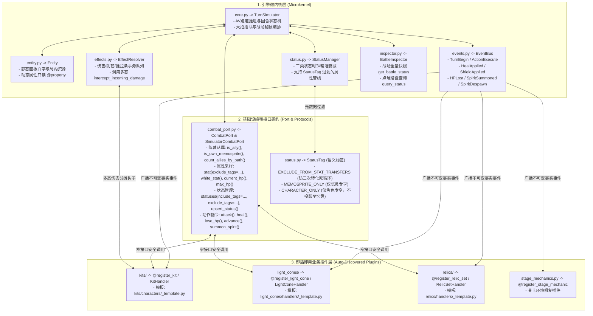

# 《星穹铁道战斗模拟器·研发工程规范与新人开发指引》 (DEVELOPER GUIDE)

> **致新加入的工程师与 Coding Agent**：  
> 本项目是一套高精度、完全解耦的《崩坏：星穹铁道》回合制战斗模拟器。  
> 为了让你在 **10 分钟内无障碍上手**，写出符合实机对账精度的代码，本手册不仅列出了**五大架构红线**，还把新人最容易踩坑的 **「官方倍率索引怎么查」「属性修改器 `ADD` vs `PERCENT` 怎么选」「Buff 时钟 `skip_current_clock` 怎么填」「本体+伴生忆灵双类怎么联动」** 全部整理成了傻瓜式速查表。

---

## 一、 核心架构图谱与模块职责边界

战斗引擎采用 **微内核 + 窄接口契约 (`CombatPort`) + 事实事件总线 (`EventBus`) + 装饰器插件自注册** 架构。核心调度器不感知任何具体的角色名、技能名、光锥名或关卡机制名。



---

## 二、 新人最容易困惑的 4 个核心细节（必看避坑指南）

### 💡 避坑 1：`self.skill_param(key, index)` 的 `key` 和 `index` 去哪查？
* **`key` 的固定取值**：
  * `"basic"`：普攻 (`Normal`)
  * `"skill"`：战技 (`BPSkill`)
  * `"ultra"`：终结技 (`Ultra`)
  * `"talent"`：天赋 (`Talent`)
  * `"technique"`：秘技 (`Maze`)
  * 或者直接传官方技能 ID 字符串（如伴生忆灵技 `"1141301"`）。
* **`index` 与官方描述 `#1`, `#2` 的对应关系**：
  打开 `data/nanoka/normalized/4.6/characters.json`（或运行下方一行命令），查看对应技能的 `desc` 和 `params_by_level`：
  * 描述里的 `#1[i]%` 对应 `index = 0`（0-indexed，即 ` param_list[0]`）；
  * 描述里的 `#2[i]%` 对应 `index = 1`（即 `param_list[1]`），以此类推！
  * **一键查询某角色官方技能参数表命令**：
    ```bash
    python3 -c 'from simulator.assets import AssetRepository; c = AssetRepository.get_instance().get_character("缇宝"); print({k: (v.name, v.type, v.desc, v.params_by_level.get(10)) for k, v in c.skills.items()})'
    ```

---

### 💡 避坑 2：`Modifier` 里的 `StatType` 和 `ModifierOp` 怎么搭配？（极易写错！）

不同属性的底层公式不同，**请严格对照下表选择 `StatType` 与 `ModifierOp`**：

| 你想实现的游戏效果 | 正确的 `StatType` | 正确的 `ModifierOp` | `value` 填法示例 | 底层计算逻辑说明 |
| :--- | :--- | :--- | :--- | :--- |
| **速度提高 16%（百分比提速）** | `StatType.SPEED` | **`ModifierOp.PERCENT`** | `0.16` | `基础白字速度 * 0.16`（若错用 `ADD` 会变成 +0.16 点速度！） |
| **速度提高 25 点（固定值提速）** | `StatType.SPEED` | **`ModifierOp.ADD`** | `25.0` | 直接加算 `+25.0` 点速度 |
| **攻击力提高 40%（百分比加攻）** | `StatType.ATK_PERCENT` | **`ModifierOp.PERCENT`** (或 `ADD`) | `0.40` | `基础白字攻击 * 0.40` |
| **攻击力提高 600 点（固定值加攻）** | `StatType.ATK_BASE` | **`ModifierOp.ADD`** | `600.0` | 直接加算 `+600.0` 点局内攻击力（如知更鸟协奏） |
| **生命上限提高 30%（百分比加血）** | `StatType.MAX_HP_PERCENT` | **`ModifierOp.PERCENT`** | `0.30` | `基础白字生命 * 0.30` |
| **生命上限提高 2527 点（固定值加血）** | `StatType.MAX_HP_PERCENT` | **`ModifierOp.ADD`** | `2527.0` | 当 `ADD` 且 `value > 1.0` 时按固定生命值加算 |
| **暴击率 / 暴击伤害提高** | `CRIT_RATE` / `CRIT_DMG` | **`ModifierOp.ADD`** | `0.35` / `0.60` | 直接加算百分点（+35% 暴击率 / +60% 暴伤） |
| **全属性增伤 / 抗性穿透 / 敌方易伤** | `DMG_BOOST` / `RES_PEN` / `VULNERABILITY` | **`ModifierOp.ADD`** | `0.50` / `0.24` / `0.30` | 直接加算对应乘区百分点 |
| **敌方减防 / 我方无视防御** | `StatType.DEF_SHRED` | **`ModifierOp.ADD`** | `0.18` / `0.30` | 挂在敌方身上为**减防**，挂在我方身上为**无视防御**，伤害管线自动合算（上限 100%） |
| **效果抵抗 / 效果命中 / 击破特攻 / 治疗加成** | `EFFECT_RES` / `EHR` / `BREAK_EFFECT` / `OUTGOING_HEALING` | **`ModifierOp.ADD`** | `0.50` | 直接加算百分点 |

---

### 💡 避坑 3：挂载 `BuffSpec` 时，`timing` 和 `skip_current_clock` 怎么选？

在回合制游戏里，**「当前正在行动的角色给自己或队友上 Buff」** 如果不注意时钟，回合结束瞬间就会被扣掉 1 回合！请按以下 3 种场景无脑套用：

1. **常规自身/队友回合行动中施加的 Buff（按目标回合结束倒计时）**：
   * `timing = DurationTiming.TARGET_TURN_END`
   * **`skip_current_clock = True`**（⚠️ 必加！否则自身回合刚结束，3 回合的 Buff 立刻变成 2 回合）。
2. **结界/光环类技能（按施法者自身回合结束或开始倒计时，如知更鸟协奏、符玄穷观阵、阮•梅结界）**：
   * `timing = DurationTiming.CASTER_TURN_END`
   * **`skip_current_clock = True`**（施法者当回合结束不扣减，下一次轮到施法者行动结束才扣减）。
3. **持续伤害 (DoT) 或目标每回合开始扣减的 Buff（如长夜月战技暴伤分享）**：
   * `timing = DurationTiming.TARGET_TURN_START`
   * `skip_current_clock = False`（下次该目标回合开始时正常扣减 1 回合）。
4. **常驻被动或光环（永不按回合自动过期，仅由机制手动移除）**：
   * `duration = None`

---

### 💡 避坑 4：二次属性转化（如“按自身暴伤的 24% 提高队友暴伤”）如何防死循环？

当角色 A 的技能需要读取自身实时属性（如暴伤、攻击力），并转化为自身或伴生忆灵的 Buff 时：
1. **给转化出来的 Buff 打上隔离标签**：
   在 `BuffSpec` 中声明 `tags=(StatusTag.EXCLUDE_FROM_STAT_TRANSFERS,)`（如果是只给忆灵的 Buff，同时加上 `StatusTag.MEMOSPRITE_ONLY`）。
2. **读取基准属性时排除该标签**：
   ```python
   own_cd = self.port.stat(
       self.owner_id,
       StatType.CRIT_DMG,
       exclude_tags=(StatusTag.EXCLUDE_FROM_STAT_TRANSFERS, StatusTag.MEMOSPRITE_ONLY)
   )
   ```
   这样无论刷新多少次，都不会把“转化出去的暴伤”再次算进本体基准里！

---

## 三、 严禁触犯的五大「红线戒律」 (Anti-Patterns)

任何提交的代码若违反以下任意一条，均视为**不合格代码**：

1. **❌ 戒律 1：严禁在核心引擎 (`core.py`, `entity.py`, `effects.py`, `status.py`, `character_db.py`) 中硬编码任何角色名、技能名或角色 ID**
   * 伤害分摊请覆写 `KitHandler.intercept_incoming_damage`；战前白字校准请覆写 `KitHandler.apply_trace_passives`；特殊大招能量请覆写 `can_cast_ultimate` / `consume_ultimate_cost`。
2. **❌ 戒律 2：严禁插件跨层访问 `self.port.sim` 或 `self.port._get_entity`，严禁角色 Kit 直接调用光锥/遗器方法**
   * 角色 Kit 一律只调 `self.port.*`；光锥与遗器通过 `on_event` 监听 `HPLostEvent`、`HealAppliedEvent`、`SpiritDespawnEvent`、`ActionExecuteEvent` 自动响应。
3. **❌ 戒律 3：严禁在属性汇算或状态过滤中使用硬编码状态 ID / 名称黑名单**
   * 一律使用 `StatusTag`（`EXCLUDE_FROM_STAT_TRANSFERS`、`MEMOSPRITE_ONLY`、`CHARACTER_ONLY`）配合 `self.port.stat(..., exclude_tags=...)` 或 `self.port.statuses(..., exclude_tags=...)`。
4. **❌ 戒律 4：严禁靠技能中文名称子串模糊匹配事件，严禁写死召唤物名字判定从属关系**
   * 事件判断一律用 `isinstance(event, HealAppliedEvent)`；从属关系一律用 `self.port.is_own_memosprite(self.owner_id, entity_id)`。
5. **❌ 戒律 5：严禁在快照与测试中篡改状态名称或伪造断言**
   * 测试用例必须与实机面板浮点及 `STAGE_CONFIG["mechanics"]` 动态对账。

---

## 四、 插件标准扩展钩子总表 (Extension Hooks Reference)

### 角色与伴生忆灵套件 (`KitHandler` - [`simulator/kits/base.py`](file:///Users/yunkaichen/Downloads/starrail/simulator/kits/base.py))

| 钩子方法 | 触发时机与职责 | 是否必填 | 典型参考实现 |
| :--- | :--- | :---: | :--- |
| `definition(kind)` | 声明普攻/战技/终结技/秘技的目标模式、SP/能量消耗、秘技 `priority` 与显示 `tag` | **必填** | 所有角色与忆灵 |
| `execute(ctx)` | 执行具体动作逻辑（调用 `self.port.attack` / `heal` / `upsert_status` 等） | **必填** | 所有角色与忆灵 |
| `apply_trace_passives(entity)` | 战前静态组装阶段：注入行迹常驻属性或校准角色基础白字 | 可选 | [`fengjin.py`](file:///Users/yunkaichen/Downloads/starrail/simulator/kits/characters/fengjin.py)、[`changyeyue.py`](file:///Users/yunkaichen/Downloads/starrail/simulator/kits/characters/changyeyue.py) |
| `get_initial_sp_cap()` | 进战前修改全队战技点上限 | 可选 | [`sparkle.py`](file:///Users/yunkaichen/Downloads/starrail/simulator/kits/characters/sparkle.py)（花火 SP 上限 7/8） |
| `on_battle_start()` | 进战时激活常驻光环、进战回能、自动召唤伴生忆灵 | 可选 | [`changyeyue.py`](file:///Users/yunkaichen/Downloads/starrail/simulator/kits/characters/changyeyue.py)、[`tibao.py`](file:///Users/yunkaichen/Downloads/starrail/simulator/kits/characters/tibao.py) |
| `on_event(event)` | 响应 `EventBus` 广播的领域事件 (`ActionExecuteEvent`, `HealAppliedEvent` 等) | 可选 | [`robin_sunnysong.py`](file:///Users/yunkaichen/Downloads/starrail/simulator/kits/characters/robin_sunnysong.py) |
| `on_hp_lost(entity_id, loss, cause)` | 场上实体损失生命值时回调 | 可选 | [`changyeyue.py`](file:///Users/yunkaichen/Downloads/starrail/simulator/kits/characters/changyeyue.py)、[`fuxuan.py`](file:///Users/yunkaichen/Downloads/starrail/simulator/kits/characters/fuxuan.py) |
| `intercept_incoming_damage(target_id, raw_dmg)` | 伤害结算前拦截/分摊伤害，返回目标实际承受伤害 | 可选 | [`fuxuan.py`](file:///Users/yunkaichen/Downloads/starrail/simulator/kits/characters/fuxuan.py)（穷观阵 65% 分摊） |
| `can_cast_ultimate(entity)` / `consume_ultimate_cost(entity)` | 自定义特殊大招充能就绪条件与扣除逻辑 | 可选 | [`acheron.py`](file:///Users/yunkaichen/Downloads/starrail/simulator/kits/characters/acheron.py)（黄泉残梦层数） |
| `get_memosprite_snapshot()` | 返回伴生忆灵独立实时战斗面板快照 | 可选 | [`changyeyue.py`](file:///Users/yunkaichen/Downloads/starrail/simulator/kits/characters/changyeyue.py) |

---

## 五、 新人 3 分钟即插即用开发 SOP

1. **开发新角色 / 伴生忆灵**：
   * 复制 [`simulator/kits/characters/_template.py`](file:///Users/yunkaichen/Downloads/starrail/simulator/kits/characters/_template.py) 为 `simulator/kits/characters/<char_pinyin>.py`（模板内同时包含**普通角色模板**与**记忆命途本体+伴生忆灵双类联动模板**）；
   * 取消 `@register_kit("<avatar_id>", "<中文名>", "<english_name>")` 注释，**无需修改 `registry.py`**，系统会自动发现并注册。
2. **开发新光锥**：
   * 复制 [`simulator/light_cones/handlers/_template.py`](file:///Users/yunkaichen/Downloads/starrail/simulator/light_cones/handlers/_template.py) 为 `simulator/light_cones/handlers/<lc_name>.py`；
   * 取消 `@register_light_cone(...)` 注释，**无需修改 `catalog.py`**。
3. **开发新遗器套装 / 关卡机制**：
   * 遗器复制 [`simulator/relics/handlers/_template.py`](file:///Users/yunkaichen/Downloads/starrail/simulator/relics/handlers/_template.py) 并加上 `@register_relic_set(...)`；
   * 关卡机制在 [`simulator/stage_mechanics.py`](file:///Users/yunkaichen/Downloads/starrail/simulator/stage_mechanics.py) 中加上 `@register_stage_mechanic(...)`。
4. **编写单元测试并运行验证**：
   * 在项目根目录执行标准测试命令，确保全部绿灯：
     ```bash
     python3 -m unittest discover -s simulator -t . -p "test_*.py" -v
     ```
