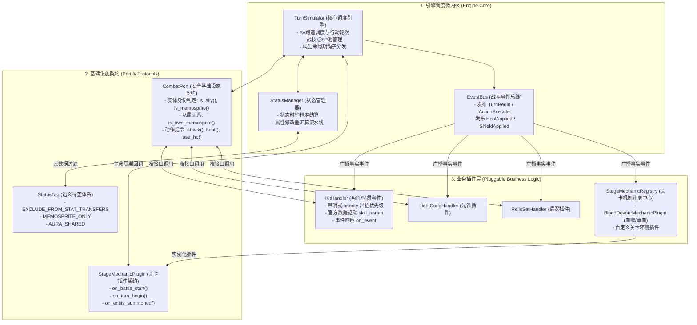

# 《星穹铁道战斗模拟器·研发工程规范与新人开发指引》 (DEVELOPER GUIDE)

> **致新加入的工程师与 Coding Agent**：  
> 本项目是一套高精度、完全解耦的《崩坏：星穹铁道》回合制战斗模拟器。  
> 为了杜绝“随手写硬编码、换个名字就报错、跨模块强耦合”的技术负债，**本项目所有后续代码研发、重构与排障必须严格遵循本说明书中的公式化规范**。  
> 若未来因官方机制更新需调整规范，必须**同步更新本说明书**。

---

## 一、 核心架构图谱与系统拓扑

战斗引擎采用 **微内核 + 插件化协议** 架构。核心调度器不感知任何具体的角色名、技能名或关卡机制名。



---

## 二、 严禁触犯的五大「红线戒律」 (Anti-Patterns)

任何提交的代码若违反以下任意一条，均视为**不合格代码**，必须立即打回重构：

### ❌ 戒律 1：严禁在核心引擎 (`core.py`) 中硬编码任何具体玩法名或数值
* **错误反例**：
  ```python
  # ❌ 绝不允许：核心引擎直接感知关卡名称 "血" 或写死 500.0 魔数
  if hasattr(self, "stage_mechanics") and any("血" in m for m in self.stage_mechanics):
      self.port.lose_hp(active_entity.name, 500.0, cause="stage_mechanic_bleed")
  if "花火" in e.name:
      self.port.set_sp_cap(7)
  ```
* **正确规范**：
  所有关卡环境逻辑必须封装在 [`StageMechanicPlugin`](file:///Users/yunkaichen/Downloads/starrail/simulator/stage_mechanics.py#L12) 插件中；角色被动通过角色 Kit 的契约方法动态读取：
  ```python
  # ✅ 正确做法：核心引擎仅通过插件协议与 Kit 协议调度
  for plugin in self.stage_plugins:
      plugin.on_turn_begin(active_entity, self)
  if getattr(e, "kit", None) and hasattr(e.kit, "get_initial_sp_cap"):
      self.port.set_sp_cap(e.kit.get_initial_sp_cap())
  ```

---

### ❌ 戒律 2：严禁在属性汇算中使用硬编码状态 ID 黑名单
* **错误反例**：
  ```python
  # ❌ 绝不允许：靠 ID 黑名单排除跨角色/跨忆灵状态，新增一个装备就会崩漏
  if s.id in ("LC_IfTimeWereAFlower_Oracle", "Relic_Valkyrie_CritDmg_长夜", "Robin_Talent_TonalChord_长夜"):
      continue
  ```
* **正确规范**：
  在 Buff 生成时打上 [`StatusTag`](file:///Users/yunkaichen/Downloads/starrail/simulator/status.py#L73) 语义标签，汇算逻辑依据标签通用过滤：
  ```python
  # ✅ 正确做法：基于语义标签解耦过滤
  from ...status import StatusTag
  if StatusTag.EXCLUDE_FROM_STAT_TRANSFERS in s.tags or StatusTag.MEMOSPRITE_ONLY in s.tags:
      continue
  ```

---

### ❌ 戒律 3：严禁依靠技能名称或描述的字符串模糊匹配触发机制
* **错误反例**：
  ```python
  # ❌ 绝不允许：靠汉字子串判断技能是否是治疗/护盾
  if "天气正好" in event.technique_name or "治" in event.technique_name or "盾" in event.technique_name:
      self.gain_vibes(1)
  ```
* **正确规范**：
  底层行为发生时发布标准领域事实事件（如 [`HealAppliedEvent`](file:///Users/yunkaichen/Downloads/starrail/simulator/events.py#L100)、[`ShieldAppliedEvent`](file:///Users/yunkaichen/Downloads/starrail/simulator/events.py#L107)），上层 Kit 仅监听事实事件：
  ```python
  # ✅ 正确做法：监听标准领域事实事件
  from ...events import HealAppliedEvent
  if isinstance(event, HealAppliedEvent):
      if self.port.is_ally(event.source_name) and event.source_name != self.owner_id:
          self.gain_vibes(1)
  ```

---

### ❌ 戒律 4：严禁对实体从属关系使用字符串等值硬编码
* **错误反例**：
  ```python
  # ❌ 绝不允许：写死具体忆灵名字 "长夜"，导致改名或新增忆灵时失效
  if entity_id == "长夜" or "长夜" in actor_name:
      ...
  ```
* **正确规范**：
  必须调用 [`CombatPort`](file:///Users/yunkaichen/Downloads/starrail/simulator/combat_port.py#L23) 面向对象的查询方法：
  ```python
  # ✅ 正确做法：面向对象判定从属与身份
  if self.port.is_own_memosprite(self.owner_id, entity_id):
      ...
  if self.port.is_ally(actor_name):
      ...
  ```

---

### ❌ 戒律 5：严禁在快照与测试中篡改状态名称或伪造断言
* **错误反例**：
  ```python
  # ❌ 绝不允许：为了迎合测试拼写错误而在业务代码中强行偷换名称
  if name == "血噬":
      name = "血嗜"
  other_effects = other_effects if other_effects else ["血嗜"]
  ```
* **正确规范**：
  状态管理器中是什么名字，快照就客观反映什么名字；测试用例动态断言 `STAGE_CONFIG["mechanics"]`，严禁伪造测试断言。

---

## 三、 公式化开发作业程序 (SOP)

---

### SOP 1：如何编写一个新角色技能套件 (KitHandler)

新建文件路径：`simulator/kits/characters/<character_pinyin>.py`  
**直接套用以下标准骨架模板**：

```python
"""<角色名> (<英文名> - ID <avatar_id>, <属性> / <命途>) 标准战斗技能套件。"""
from typing import Optional, Any
from ..base import KitHandler
from ...actions import ActionContext, ActionKind, AbilityDefinition, ResourceCost, TargetMode
from ...combat_port import BuffSpec, CombatPort
from ...status import DurationTiming, Modifier, ModifierOp, StatType, StatusTag


class ExampleCharacterKit(KitHandler):
    def __init__(self, owner_id: str, port: CombatPort, *, eidolon: int = 0, skill_levels: Optional[dict] = None):
        super().__init__(owner_id, port, eidolon=eidolon, skill_levels=skill_levels)
        # 1. 角色私有状态字段

    def definition(self, kind: ActionKind) -> AbilityDefinition:
        """声明技能模式、消耗与秘技优先级 (全队增益=0, 默认=1, 结界/领域=2)。"""
        if kind == ActionKind.BASIC:
            return AbilityDefinition(kind=kind, target_mode=TargetMode.SINGLE_ENEMY, cost=ResourceCost(sp=-1), name="普攻名称")
        elif kind == ActionKind.SKILL:
            return AbilityDefinition(kind=kind, target_mode=TargetMode.ALL_ALLIES, cost=ResourceCost(sp=1), name="战技名称")
        elif kind == ActionKind.ULTIMATE:
            return AbilityDefinition(kind=kind, target_mode=TargetMode.SELF, cost=ResourceCost(energy=120.0), name="终结技名称")
        elif kind == ActionKind.TECHNIQUE:
            # 必须显式声明 priority：全队增益/治疗设为 0，领域展开设为 2
            return AbilityDefinition(kind=kind, target_mode=TargetMode.ALL_ALLIES, cost=ResourceCost(technique_points=1), name="秘技名称", priority=0)
        raise ValueError(f"未支持的动作类型: {kind}")

    def on_battle_start(self) -> None:
        """进战常态被动与行迹光环注入。"""
        # 严禁写死数值！必须通过 self.skill_param 读取官方数据驱动参数
        boost_val = self.skill_param("talent", 0, default=0.20)
        self.port.upsert_status(BuffSpec(
            key=f"{self.owner_id}_Talent_Aura",
            name="天赋光环",
            source_id=self.owner_id,
            target_id=self.owner_id,
            modifiers=(Modifier(StatType.ATK_PERCENT, ModifierOp.PERCENT, boost_val),),
            duration=None,
            timing=DurationTiming.TARGET_TURN_END,
            category="buff"
        ))

    def execute(self, ctx: ActionContext) -> None:
        """动作具体执行分发。"""
        if ctx.kind == ActionKind.BASIC:
            dmg_pct = self.skill_param("normal", 0, default=1.0)
            self.port.attack(self.owner_id, ctx.target_ids[0], element="Wind", atk_multiplier=dmg_pct, toughness_damage=10.0)
            self.port.gain_energy(self.owner_id, 20.0)
        # 其余分支同理...

    def on_event(self, event: Any) -> None:
        """通过标准事件监听我方行为，绝不使用中文字符串匹配。"""
        from ...events import ActionExecuteEvent, HealAppliedEvent
        if isinstance(event, HealAppliedEvent):
            if self.port.is_ally(event.source_name) and event.source_name != self.owner_id:
                # 响应我方治疗
                pass
```

---

### SOP 2：如何实现伴生忆灵 / 召唤物 (Memosprite)

召唤物不是普通实体，必须与召唤者建立明确的主从契约：

```python
# 1. 召唤注册：必须通过 self.port.summon_spirit
spirit = self.port.summon_spirit(
    owner_id=self.owner_id,
    name=self.spirit_name,           # 使用 Kit 内部字段 self.spirit_name，严禁到处硬编码字面量
    base_speed=160.0,                # 显式传入实机速度
    max_hp=self.spirit_max_hp,       # 显式传入动态计算的生命上限
    kit_class=MemospriteKitClass,    # 绑定独立的忆灵 KitHandler
    kit_args={"master_kit": self}
)

# 2. 标记从属元数据
spirit.is_memosprite = True
spirit.master_name = self.owner_id

# 3. 忆灵专属状态打标：必须挂载 StatusTag 语义标签，防自循环与防污染本体
from ...status import StatusTag
self.port.upsert_status(BuffSpec(
    key=f"{self.owner_id}_Skill_SharedCritDmg_Spirit",
    name="白昼悄然离去",
    source_id=self.owner_id,
    target_id=self.spirit_name,
    modifiers=(Modifier(StatType.CRIT_DMG, ModifierOp.ADD, shared_cd),),
    duration=2,
    timing=DurationTiming.TARGET_TURN_START,
    category="buff",
    tags=(StatusTag.MEMOSPRITE_ONLY, StatusTag.EXCLUDE_FROM_STAT_TRANSFERS)
))
```

---

### SOP 3：如何开发/接入一个新的关卡环境机制 (StageMechanicPlugin)

新建机制无需改动 `TurnSimulator`，在 [`simulator/stage_mechanics.py`](file:///Users/yunkaichen/Downloads/starrail/simulator/stage_mechanics.py) 中定义插件并注册：

```python
from .stage_mechanics import StageMechanicPlugin, StageMechanicRegistry
from .status import StatusInstance, DurationTiming

# 1. 实现 StageMechanicPlugin 协议
class CustomHazardMechanicPlugin:
    def __init__(self, name: str = "深空辐射", hazard_value: float = 300.0):
        self.name = name
        self.hazard_value = hazard_value

    def on_battle_start(self, sim: Any) -> None:
        """进战为全场挂载机制标识。"""
        for e in sim.entities:
            sim.status_mgr.add_status(StatusInstance(
                id=f"Stage_Mechanic_{self.name}_{e.name}",
                name=self.name,
                source=e,
                target=e,
                duration=None,
                timing=DurationTiming.TARGET_TURN_END,
                modifiers=[],
                category="other",
                description="自定义关卡环境机制"
            ))

    def on_turn_begin(self, active_entity: Any, sim: Any) -> None:
        """回合开始环境响应。"""
        if not active_entity.is_enemy:
            sim.port.lose_hp(active_entity.name, self.hazard_value, cause="custom_hazard_turn")

    def on_entity_summoned(self, entity: Any, sim: Any) -> None:
        """召唤物入场环境响应。"""
        sim.port.lose_hp(entity.name, self.hazard_value, cause="custom_hazard_summon")


# 2. 注册到 StageMechanicRegistry (支持中英文别名)
StageMechanicRegistry.register("深空辐射", CustomHazardMechanicPlugin)
StageMechanicRegistry.register("SpaceRadiation", CustomHazardMechanicPlugin)
```

使用时，直接在关卡配置中指定名称即可：
```python
STAGE_CONFIG = {
    "mechanics": ["深空辐射"],  # 换名字即插即用，内核零改动！
    ...
}
```

---

### SOP 4：状态管理器与 Buff 挂载标准 (BuffSpec & StatusTag)

挂载状态时必须明确生命周期时钟与语义标签：

| 字段 | 推荐配置 | 语义含义 |
| :--- | :--- | :--- |
| `timing` | `DurationTiming.TARGET_TURN_END` | 目标自身行动结束时扣减回合数（绝大多数普通 Buff/Debuff）。 |
| `timing` | `DurationTiming.CASTER_TURN_END` | 施加者行动结束时扣减回合数（如知更鸟大招协奏、花火战技暴伤）。 |
| `skip_current_clock` | `True` | 施加当回合免扣减（行动中开大或自身回合施加时必加）。 |
| `tags` | `(StatusTag.MEMOSPRITE_ONLY,)` | 仅伴生忆灵专享，长夜月等召唤者在汇算本体面板时不计入。 |
| `tags` | `(StatusTag.EXCLUDE_FROM_STAT_TRANSFERS,)` | 排除属性二次转化（如战技根据自身暴伤分享给忆灵，防止再次回流自身导致死循环）。 |

---

### SOP 5：如何编写官方对账单元测试

单元测试必须做到**动态对账**，严禁伪造测试通过：

```python
def test_character_dynamic_status_verification(self):
    """测试模板：动态验证角色在实战环境下的全量面板对账。"""
    sim = TurnSimulator(
        entities=self.team + self.enemies,
        use_techniques=True,
        stage_mechanics=STAGE_CONFIG.get("mechanics", ["血噬"])
    )
    # 推进动作
    sim.cast_ultimate("缇宝")
    
    # 获取快照
    snap = sim.query_status("目标角色")
    buff_names = [b["name"] for b in snap["buffs"]]
    
    # 1. 动态断言增益名称
    for expected in ["期望BuffA", "期望BuffB"]:
        self.assertIn(expected, buff_names)
        
    # 2. 环境机制动态对齐配置（绝不写死）
    self.assertEqual(snap["other_effects"], STAGE_CONFIG["mechanics"])
    
    # 3. 浮点属性精准对账 (Delta 严格控制在 0.001)
    self.assertAlmostEqual(snap["current_crit_dmg"], 2.426, places=3)
```

---

## 四、 架构自审必查清单 (Pre-Commit Checklist)

在每次编写完毕、准备运行测试与提交 Git 之前，**必须逐条自问自答**：

- [ ] **1. Core 纯洁性**：检查 [`simulator/core.py`](file:///Users/yunkaichen/Downloads/starrail/simulator/core.py) 是否有新增任何特定的角色名、技能名、关卡机制字面量？（**必须为 0**）
- [ ] **2. 换名鲁棒性**：如果把关卡机制名从 `"血噬"` 改为 `"流血环境"`，或者把忆灵改名为 `"新忆灵"`，代码是否依然能通过测试？（**必须能通过**）
- [ ] **3. 事件解耦**：是否有使用 `if "字" in name` 匹配技能？是否全部替换为标准 `BattleEvent` 派生类？
- [ ] **4. 标签语义化**：是否有在属性计算中写死 `s.id == "xxx"`？是否全部替换为 `StatusTag`？
- [ ] **5. 全量绿灯**：本地运行 `pytest -v` 是否保持 **100% 全部通过**？
