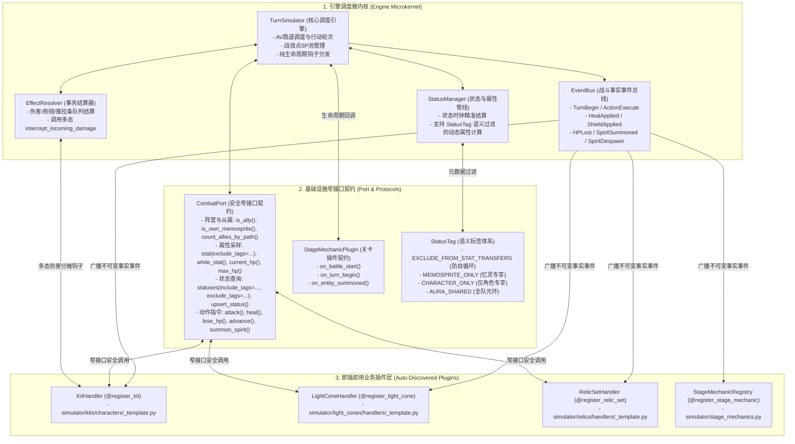

# 《星穹铁道战斗模拟器·研发工程规范与新人开发指引》 (DEVELOPER GUIDE)

> **致新加入的工程师与 Coding Agent**：  
> 本项目是一套高精度、完全解耦的《崩坏：星穹铁道》回合制战斗模拟器。  
> 为了杜绝“随手写硬编码、换个名字就报错、跨模块强耦合”的技术负债，**本项目所有后续代码研发、重构与排障必须严格遵循本说明书中的公式化规范**。  
> 新人开发新角色、新光锥或新遗器时，请直接复制各目录下的 `_template.py` 标准脚手架，配合 `@register_*` 装饰器实现**零中心文件修改**的即插即用开发。

---

## 一、 核心架构图谱与四层解耦拓扑

战斗引擎采用 **微内核 + 窄接口契约 (`CombatPort`) + 事实事件总线 (`EventBus`) + 装饰器插件自注册** 架构。核心调度器不感知任何具体的角色名、技能名、光锥名或关卡机制名。



---

## 二、 严禁触犯的五大「红线戒律」 (Anti-Patterns)

任何提交的代码若违反以下任意一条，均视为**不合格代码**，必须立即打回重构：

### ❌ 戒律 1：严禁在核心引擎 (`core.py`, `effects.py`, `status.py`, `character_db.py`) 中硬编码任何角色名、技能名或专属机制
* **错误反例**：
  ```python
  # ❌ 绝不允许：在 effects.py 中直接写死 "符玄" 分摊伤害，或在 core.py 中写死 "迷梦" 技能名
  if "符玄" in e.name and self.simulator.status_mgr.has_status(target.name, "FuXuan_Matrix"):
      shared_dmg = raw_dmg * 0.65
  ```
* **正确规范**：
  所有角色专属机制必须通过 [`KitHandler`](file:///Users/yunkaichen/Downloads/starrail/simulator/kits/base.py) 的标准多态扩展钩子实现（如伤害分摊使用 `intercept_incoming_damage`，战前白字校准使用 `apply_trace_passives`，动作分类标签使用 `AbilityDefinition.tag`）：
  ```python
  # ✅ 正确做法：effects.py 仅调用多态协议钩子，具体分摊逻辑封装在 FuXuanKit.intercept_incoming_damage 中
  for ent in list(self.simulator.entities):
      if ent.kit:
          raw_dmg = ent.kit.intercept_incoming_damage(target.name, raw_dmg)
  ```

---

### ❌ 戒律 2：严禁插件跨层访问 `self.port.sim` 或 `self.port._get_entity`，严禁角色 Kit 直接调用光锥/遗器内部方法
* **错误反例**：
  ```python
  # ❌ 绝不允许：角色 Kit 直接伸手去拿内部 Entity 并强行调用特定光锥的方法
  ent = self.port._get_entity(self.owner_id)
  if ent and hasattr(ent.light_cone, "trigger_flower_buff"):
      ent.light_cone.trigger_flower_buff()
  ```
* **正确规范**：
  角色 Kit 只管调用 `self.port.lose_hp(...)`，引擎会自动在 `EventBus` 上广播 [`HPLostEvent`](file:///Users/yunkaichen/Downloads/starrail/simulator/events.py)；光锥通过 `on_event` 独立监听 `HPLostEvent` 或 `SpiritDespawnEvent`：
  ```python
  # ✅ 正确做法：光锥通过 EventBus 监听 HPLostEvent，与角色 Kit 100% 解耦
  def on_event(self, event: Any) -> None:
      if isinstance(event, HPLostEvent):
          if event.entity_name == self.owner_id or self.port.is_own_memosprite(self.owner_id, event.entity_name):
              self.trigger_flower_buff()
  ```

---

### ❌ 戒律 3：严禁在属性汇算或状态过滤中使用硬编码状态 ID / 名称黑名单
* **错误反例**：
  ```python
  # ❌ 绝不允许：靠状态 ID 或名称黑名单排除状态
  if s.id in ("Changyeyue_Skill_SharedCritDmg", "Robin_Talent_TonalChord_长夜") or "好忙好忙" in s.name:
      continue
  ```
* **正确规范**：
  在挂载状态时打上 [`StatusTag`](file:///Users/yunkaichen/Downloads/starrail/simulator/status.py) 语义标签（`EXCLUDE_FROM_STAT_TRANSFERS`、`MEMOSPRITE_ONLY`、`CHARACTER_ONLY`），查询时直接通过 `self.port.stat(..., exclude_tags=...)` 或 `self.port.statuses(..., exclude_tags=...)` 过滤：
  ```python
  # ✅ 正确做法：基于语义标签一行完成安全采样
  own_cd = self.port.stat(
      self.owner_id,
      StatType.CRIT_DMG,
      exclude_tags=(StatusTag.EXCLUDE_FROM_STAT_TRANSFERS, StatusTag.MEMOSPRITE_ONLY)
  )
  ```

---

### ❌ 戒律 4：严禁依靠技能名称字符串模糊匹配触发事件，严禁对实体从属关系使用名字等值硬编码
* **错误反例**：
  ```python
  # ❌ 绝不允许：靠汉字子串判断技能类型或写死忆灵名字
  if "治" in event.technique_name or entity_id == "长夜":
      ...
  ```
* **正确规范**：
  统一监听强类型 `BattleEvent` 子类（`HealAppliedEvent`, `ShieldAppliedEvent`, `HPLostEvent`, `ActionExecuteEvent`），并调用 `self.port.is_own_memosprite(self.owner_id, entity_id)` 或 `self.port.count_allies_by_path(self.owner_id, "Remembrance")`。

---

### ❌ 戒律 5：严禁在快照与测试中篡改状态名称或伪造断言
* 状态管理器中是什么名字，快照就客观反映什么名字；测试用例动态断言 `STAGE_CONFIG["mechanics"]`。

---

## 三、 插件标准扩展钩子总表 (Extension Hooks Reference)

### 1. 角色与伴生忆灵套件 (`KitHandler` - [`simulator/kits/base.py`](file:///Users/yunkaichen/Downloads/starrail/simulator/kits/base.py))

| 钩子方法 | 触发时机与职责 | 是否必填 | 典型应用场景 |
| :--- | :--- | :---: | :--- |
| `definition(kind)` | 声明普攻/战技/终结技/秘技的目标模式、SP/能量消耗、秘技 `priority` 与显示 `tag` | **必填** | 所有角色与忆灵 |
| `execute(ctx)` | 执行具体动作逻辑（调用 `self.port.attack` / `heal` / `upsert_status` 等） | **必填** | 所有角色与忆灵 |
| `apply_trace_passives(entity)` | 战前静态组装阶段：注入行迹常驻属性或校准角色基础白字 | 可选 | 风堇暴击/抵抗行迹、长夜月/缇宝白字校准 |
| `get_initial_sp_cap()` | 进战前修改全队战技点上限 | 可选 | 花火天赋（SP 上限提升至 7/8 点） |
| `on_battle_start()` | 进战时激活常驻光环、进战回能、自动召唤伴生忆灵 | 可选 | 长夜月召唤长夜、缇宝进战回能 |
| `on_event(event)` | 响应 `EventBus` 广播的领域事件 (`ActionExecuteEvent`, `HealAppliedEvent` 等) | 可选 | 知更鸟晴歌攒气氛值、缇宝队友大招追击 |
| `on_hp_lost(entity_id, loss, cause)` | 场上实体损失生命值时回调 | 可选 | 长夜月扣血攒忆质、符玄半血翻转回血、风堇E2提速 |
| `intercept_incoming_damage(target_id, raw_dmg)` | 伤害结算前拦截/分摊伤害，返回目标实际承受伤害 | 可选 | 符玄穷观阵分摊队友 65% 伤害 |
| `can_cast_ultimate(entity)` / `consume_ultimate_cost(entity)` | 自定义特殊大招充能就绪条件与扣除逻辑 | 可选 | 黄泉残梦层数、飞霄飞黄点 |
| `get_memosprite_snapshot()` | 返回伴生忆灵独立实时战斗面板快照 | 可选 | 长夜月伴生忆灵「长夜」状态透析 |

---

## 四、 新人 3 分钟即插即用开发 SOP

### SOP 1：新增一个角色技能套件 (`@register_kit`)
1. 复制模板文件 [`simulator/kits/characters/_template.py`](file:///Users/yunkaichen/Downloads/starrail/simulator/kits/characters/_template.py) 为 `simulator/kits/characters/<char_pinyin>.py`；
2. 在类定义上方添加 `@register_kit("<avatar_id>", "<中文名>", "<english_name>")`；
3. 实现 `definition()` 与 `execute()`，所有技能倍率通过 `self.skill_param("basic"|"skill"|"ultra"|"talent", index, default=...)` 读取；
4. **无需修改 `registry.py`**，直接通过 `db.to_combat_entity("<中文名>")` 即可加载并参战！

### SOP 2：新增一个专属光锥 (`@register_light_cone`)
1. 复制模板文件 [`simulator/light_cones/handlers/_template.py`](file:///Users/yunkaichen/Downloads/starrail/simulator/light_cones/handlers/_template.py) 为 `simulator/light_cones/handlers/<lc_name>.py`；
2. 添加装饰器 `@register_light_cone(cone_id="...", name="...", path="...", aliases=(...))`；
3. 使用 `self.scale(VALUES_TUPLE)` 读取 S1~S5 叠影数值，在 `on_battle_start` / `on_action_after` / `on_event` 中通过 `self.port.upsert_status(BuffSpec(...))` 挂载效果（注意：攻击者身上的无视防御同样使用 `StatType.DEF_SHRED`，伤害引擎会自动将攻击者无视防御与敌方减防相加）。

### SOP 3：新增一个遗器套装 (`@register_relic_set`) 或关卡机制 (`@register_stage_mechanic`)
* **遗器套装**：复制 [`simulator/relics/handlers/_template.py`](file:///Users/yunkaichen/Downloads/starrail/simulator/relics/handlers/_template.py)，加上 `@register_relic_set(set_id=..., name=..., set_type="cavern"|"planar")`。
* **关卡机制**：在 [`simulator/stage_mechanics.py`](file:///Users/yunkaichen/Downloads/starrail/simulator/stage_mechanics.py) 中定义插件类并加上 `@register_stage_mechanic("机制名", "别名")`。

---

## 五、 架构自审必查清单 (Pre-Commit Checklist)

在每次编写完毕、准备提交 Git 之前，**必须逐条自问自答并执行测试命令**：

- [ ] **1. Core 纯洁性**：检查 `simulator/core.py`、`simulator/effects.py`、`simulator/status.py`、`simulator/db/character_db.py` 是否有新增任何特定角色名、技能名或角色 ID 判断？（**必须为 0**）
- [ ] **2. 窄接口合规性**：新增的 Kit / 光锥 / 遗器是否只调用了 `self.port.*` 契约方法，没有任何 `self.port.sim` 或 `self.port._get_entity` 跨层调用？（**必须为 0**）
- [ ] **3. 事件与标签解耦**：是否有使用中文子串匹配技能或写死状态 ID 黑名单？是否全部替换为 `BattleEvent` 派生类与 `StatusTag`？
- [ ] **4. 全量测试绿灯**：在项目根目录运行以下命令是否 **100% 全部通过**？
  ```bash
  python3 -m unittest discover -s simulator -t . -p "test_*.py" -v
  ```
