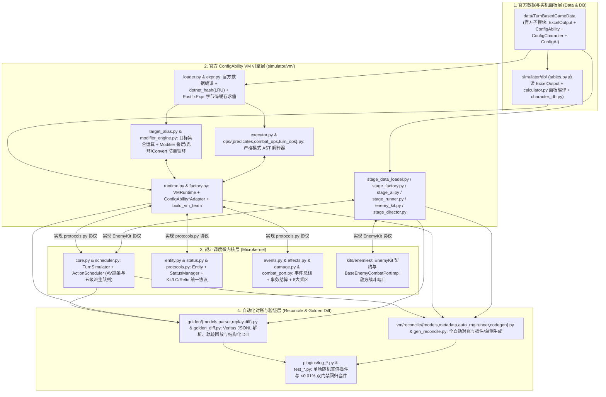

# 崩坏：星穹铁道 官方 ConfigAbility VM 战斗模拟器 (Star Rail Combat Simulator)

一个以**官方 `TurnBasedGameData` + `ConfigAbility` 纯数据驱动虚拟机 (VM)** 为唯一核心、结合**微内核 AV 调度引擎 (`TurnSimulator`)** 与**黄金日志实机对账框架**的《崩坏：星穹铁道》回合制战斗模拟器。

> **架构主线**：角色、伴生忆灵、光锥、遗器、怪物与关卡波次/AI **100% 由官方 `data/TurnBasedGameData/` 配置与 `ExcelOutput` 数值表驱动**，零手写角色/光锥/遗器/关卡代码。关卡 `30126122` 全部 9 份官方实机日志已达成总伤与逐动误差 **`< 0.01%`**（全仓 59 项测试全绿）。

> 📘 **研发与架构文档导航**：
> - **官方 VM 引擎架构详解**：[《ConfigAbility VM 引擎架构与运行机制 (docs/VM_ARCHITECTURE.md)》](docs/VM_ARCHITECTURE.md)
> - **研发工程规范与开发指引**：[《研发工程规范与开发指引 (DEVELOPER_GUIDE.md)》](DEVELOPER_GUIDE.md)
> - **代码索引与架构速查**：[《代码索引与架构速查表 (CODEBASE_INDEX.md)》](CODEBASE_INDEX.md)

---

## 🌟 四层解耦总体架构



---

## 🚀 环境准备与快速启动

### 1. 环境与子模块初始化

```bash
# 拉取官方数据子模块 (data/TurnBasedGameData)
git submodule update --init --recursive

# 安装依赖 (核心引擎纯标准库，测试使用 pytest)
pip install -r requirements.txt
```

### 2. 运行测试套件

```bash
# 1. 运行全仓 59 项测试（微内核 + VM 单元测试 + 数据驱动关卡 + 9 份实机日志 <0.01% 对齐）
pytest simulator/ -v

# 2. 快速运行微内核与协议单测 (~0.3s)
pytest simulator/ --ignore=simulator/vm -q

# 3. 运行 VM 核心单元与覆盖率审计测试
pytest simulator/vm/test_vm_phase1.py simulator/vm/test_vm_hyacine_team.py simulator/vm/test_audit_vm_coverage.py -v

# 4. 运行关卡 30126122 全部 9 份官方日志对账测试 (<0.01% 门禁)
pytest simulator/vm/test_vm_30126122_alignment.py -v
```

### 3. 一键官方日志对账与插件/单测生成

```bash
# 对任意官方 Veritas battle_*.jsonl 日志执行纯数据驱动 VM 对账
python gen_reconcile.py battle_logs/battle_20261115_041608.jsonl --data-driven

# 自动提取 RNG 真值生成单场插件与对账单测
python gen_reconcile.py battle_logs/<battle_log>.jsonl --data-driven --no-plugin --emit-plugin --emit-test

# 生成 Markdown 轨迹对比报告
python -m simulator.golden_diff battle_logs/battle_20261115_041608.jsonl --trajectory
```

---

## 📁 目录结构

```
StarRail-Combat-Simulator/
├── simulator/
│   ├── vm/                             # 官方 ConfigAbility 数据驱动 VM 引擎
│   │   ├── loader.py                   #   ExcelOutput & ConfigAbility 编译、ReadInfo 参数与表现节点裁剪
│   │   ├── expr.py                     #   dotnet_hash (LRU) & PostfixExpr 字节码缓存求值器
│   │   ├── target_alias.py             #   TargetAlias 集合运算与链式修饰符解析
│   │   ├── modifier_engine.py          #   Modifier 叠层/生命周期/光环/Priority 回调/Convert 防自循环
│   │   ├── executor.py                 #   TaskExecutor 主调度器 (strict=True)
│   │   ├── ops/                        #   VM 算子分包 (predicates.py / combat_ops.py / turn_ops.py)
│   │   ├── runtime.py & factory.py     #   VMRuntime、ConfigAbility*Adapter 与 build_vm_team
│   │   ├── stage_data_loader.py        #   官方 StageConfig / MonsterConfig / MonsterTemplate 编译
│   │   ├── stage_factory.py            #   数据驱动怪物实体与 BattleEvent 工厂
│   │   ├── stage_ai.py                 #   官方 ConfigAI 决策树编译与执行器
│   │   ├── stage_runner.py             #   纯数据驱动波次/锁血/阶段切换/召唤状态机
│   │   ├── enemy_kit.py                #   DataDrivenEnemyKit (桥接 ConfigAI + ConfigAbility 敌方技能)
│   │   ├── stage_director.py           #   DataDrivenStageDirector & build_data_driven_stage
│   │   ├── stage_sim_adapter.py        #   数据驱动关卡适配器兼容门面
│   │   ├── reconcile/                  #   自动对账子包 (models / metadata / auto_rng / runner / codegen)
│   │   ├── reconcile_generator.py      #   自动对账与插件/单测生成器 CLI 门面
│   │   ├── ir_compiler.py              #   全局 DynamicHash 反查表、混淆 OpCode 注册与扁平 IR 编译缓存
│   │   ├── audit_vm_coverage.py        #   全量官方数据 AST 算子覆盖率审计工具
│   │   ├── state_bridge.py & causal_tracer.py  # VM 运行态只读快照与因果追踪
│   │   └── test_*.py                   #   VM 单元测试、关卡测试、自动对账与 9 份实机日志对齐测试
│   │
│   ├── core.py & scheduler.py          # AV 跑条调度微内核与五级派生队列调度器
│   ├── entity.py & status.py           # 战斗实体模型、动态属性管线与语义标签
│   ├── protocols.py                    # 统一行为处理器协议 (KitHandler / LightConeHandler / RelicSetHandler)
│   ├── combat_port.py                  # 插件安全窄接口契约与四阶段召唤屏障
│   ├── events.py & effects.py          # 领域事实事件总线与效果事务结算
│   ├── damage.py & sp.py & actions.py  # 8 大乘区纯函数伤害计算、战技点池与动作/伤害枚举
│   ├── inspector.py & tracer.py        # 只读战场快照查询与因果追踪器
│   ├── stage_director.py               # 混沌回忆/异象仲裁波次模式与弱点击破工具
│   ├── stage_mechanics.py              # 通用关卡环境词条插件协议
│   ├── kits/enemies/                   # 敌方协议基类 (EnemyKit) 与敌方战斗端口 (BaseEnemyCombatPortImpl)
│   ├── db/                             # 官方 ExcelOutput 数值直读 (tables.py)、精确面板计算与 CharacterDB
│   ├── golden/                         # Golden Trace 子包 (models / parser / replay / diff)
│   ├── golden_diff.py                  # Veritas JSONL 对账与轨迹回放 CLI 门面
│   ├── plugins/                        # 单场日志专属 RNG 插件 (log_<tag>.py，内含 NON_CRITS 账本)
│   └── test_*.py                       # 微内核与协议单元测试
│
├── data/
│   ├── TurnBasedGameData/              # 【Git Submodule】官方游戏配置与 Excel 数值表（唯一真相源）
│   └── character_db_export.json        # 实机导出的账号角色配置与遗器词条库
├── docs/                               # VM 架构设计、蓝图与 API 调试参考文档
├── battle_logs/                        # 官方实机录制 Veritas JSONL 日志
├── gen_reconcile.py                    # 官方日志一键 VM 对账入口脚本
├── DEVELOPER_GUIDE.md                  # 研发工程规范与开发指引
└── CODEBASE_INDEX.md                   # 代码索引与架构速查表
```
