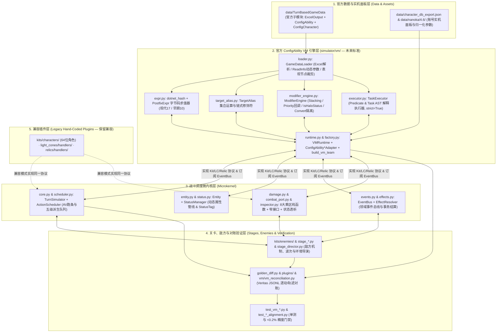

# 崩坏：星穹铁道 回合制战斗与官方 ConfigAbility VM 模拟器 (Star Rail Combat Simulator)

一个以**官方 `TurnBasedGameData` + `ConfigAbility` 数据驱动虚拟机 (VM)** 为核心标准、结合**微内核 AV 调度引擎 (`TurnSimulator`)** 与**黄金日志实机对账框架**的《崩坏：星穹铁道》回合制战斗模拟器。

> **架构主线说明**：本项目已引入官方 `ConfigAbility` 运行时虚拟机（[`simulator/vm/`](simulator/vm/)）并挂载官方配置仓库（[`data/TurnBasedGameData/`](data/TurnBasedGameData/)）。**后续所有新角色、伴生忆灵、光锥与遗器均以官方 VM 引擎为唯一准绳推进**；早期手写 Python 插件体系（[`simulator/kits/characters/`](simulator/kits/characters/)、[`simulator/light_cones/handlers/`](simulator/light_cones/handlers/)、[`simulator/relics/handlers/`](simulator/relics/handlers/)）保留为兼容层，二者共享同一套 `KitHandler` / `LightConeHandler` / `RelicSetHandler` 与 `CombatPort` 协议接入 `TurnSimulator`。

> 📘 **研发与架构文档导航**：
> - **官方 VM 引擎架构详解**：[《ConfigAbility VM 引擎架构与运行机制 (docs/VM_ARCHITECTURE.md)》](docs/VM_ARCHITECTURE.md) —— 编译器、`.NET` 哈希与 `PostfixExpr` 字节码、`ModifierEngine`、`TaskExecutor` 与 `TurnSimulator` 桥接设计。
> - **研发工程规范与开发指引**：[《星穹铁道战斗模拟器·研发工程规范与开发指引 (DEVELOPER_GUIDE.md)》](DEVELOPER_GUIDE.md) —— VM 优先开发 SOP、节点拓展方法、对账规范与兼容层（Legacy）避坑指南。
> - **代码索引与架构速查**：[《代码索引与架构速查表 (CODEBASE_INDEX.md)》](CODEBASE_INDEX.md) —— 秒级定位 VM 模块、微内核、敌方/关卡、对账沙盒与测试套件。

---

## 🌟 五层解耦总体架构



### 核心设计原则

1. **官方配置单一真相源 (`data/TurnBasedGameData` → `simulator/vm/`)**：
   - 直接读取官方 `ExcelOutput`（技能倍率、星魂 `SkillAddLevelList`、行迹 `AvatarSkillTreeConfig`、忆灵继承 `AvatarServantConfig`、光锥 `EquipmentSkillConfig`、遗器 `RelicSetSkillConfig`）与 `ConfigAbility` / `ConfigGlobalModifier` / `ConfigGlobalTaskListTemplate` JSON AST；
   - 严格按照官方 `Priority` 升序（如 `-92 → -80 → 0`）调度事件回调，`TaskExecutor` 在 `strict=True` 下遇到未实现的逻辑 `$type` 直接抛出 `NotImplementedError`，杜绝静默跳过与手写拍脑袋逻辑。
2. **微内核与业务逻辑严格隔离 (`simulator/core.py`, `scheduler.py`, `combat_port.py`)**：
   - `TurnSimulator` 与 `ActionScheduler` 负责 `10,000 / Speed` AV 跑条、五级优先级派生队列（`IMMEDIATE_EXTRA_TURN` → `FOLLOW_UP` → `RESERVED` → `VOYAGE` → 自然回合）、`StatusManager` 属性汇算与 `DamageCalculator` 8 大乘区计算；
   - `VMRuntime` 通过 `ConfigAbilityKitAdapter`、`ConfigAbilityLightConeAdapter`、`ConfigAbilityRelicAdapter` 标准适配器无缝接入微内核，**无需在微内核硬编码任何角色或装备规则**。
3. **白盒属性防自循环与精密面板去重**：
   - 官方 `*Convert` 属性（如 `SpeedConvert`、`CriticalDamageConvert`、`HPConvert`、`HealRatioConvert`）自动映射 `StatusTag.EXCLUDE_FROM_STAT_TRANSFERS`，彻底防止二次转化死循环；
   - [`simulator/vm/factory.py`](simulator/vm/factory.py) 在从 `character_db_export.json` 装配 VM 实体时，会自动扣除面板已预烘焙但 VM 进场会主动施放的被动词条（如风堇行迹/内圈、拾骨地等），避免双重叠加。
4. **实机 Veritas 日志零循环自证对账 (`golden_diff.py`, `vm_reconciliation.py`)**：
   - 支持直接读取 `battle_logs/battle_*.jsonl` 进行全轨迹回放（`run_trajectory_replay`）与 VM 逐动沙盒对账（`VMReconciliationHarness`），以全场总伤与逐动误差 `< 0.2%` 为工程验收标准。

---

## 🚀 环境准备与快速启动

### 1. 环境与子模块初始化

本项目核心引擎与 VM 基于 Python 3.9+ 标准库实现（测试使用 `pytest`）：

```bash
# 1. 拉取官方数据子模块 (data/TurnBasedGameData)
git submodule update --init --recursive

# 2. 安装测试依赖
pip install -r requirements.txt
```

### 2. 运行测试与 VM 验证

> ⚠️ **注意**：`scratch/` 目录存放临时实验脚本，执行 `pytest` 时建议指定目标测试路径（避免裸跑 `pytest` 扫入 `scratch/`）。

```bash
# 1. 运行官方 VM 引擎核心单测（表达式字节码 / 数值加载 / 记忆队进场与治疗验证）
pytest simulator/vm/test_vm_phase1.py simulator/vm/test_vm_hyacine_team.py -v

# 2. 运行架构拓展性与代码规范审计测试
pytest simulator/test_framework_extensibility.py simulator/test_code_integrity.py -v

# 3. 运行关卡 30126122 官方黄金日志对齐测试
pytest simulator/test_30126122_alignment.py simulator/test_stage_30126122_enemies.py -v

# 4. 或使用标准库 unittest 运行 simulator 下的 test_*.py
python -m unittest discover -s simulator -t . -p "test_*.py" -v
```

### 3. 命令行模拟与日志对账工具

```bash
# 交互式打牌 / 自动排轴 CLI
python simulate_battle.py -i

# 机械化查询指定步数的回合归属、可选 Action 与实时面板
python query_turn_action.py --step 0 --status 长夜

# 对官方 Veritas battle_*.jsonl 日志执行结构化时序 Diff
python -m simulator.golden_diff battle_logs/battle_20261025_131019.jsonl
```

---

## 📁 目录结构

```
StarRail-Combat-Simulator/
├── simulator/
│   ├── vm/                             # 【核心标准】官方 ConfigAbility 数据驱动 VM 引擎
│   │   ├── loader.py                   #   ExcelOutput & ConfigAbility 编译器、ReadInfo 解析与 AST 裁剪
│   │   ├── expr.py                     #   .NET 32-bit 哈希与 PostfixExpr 字节码求值器 (支持现代/早期格式)
│   │   ├── target_alias.py             #   TargetAlias 集合运算 (+/-) 与链式修饰符解析
│   │   ├── modifier_engine.py          #   VMModifierInstance 宿主、Priority 回调调度、光环与 Convert 隔离
│   │   ├── executor.py                 #   Task & Predicate AST 解释器与战斗结算桥接
│   │   ├── runtime.py                  #   VMRuntime 协调器与 Kit / LightCone / Relic 标准适配器
│   │   ├── factory.py                  #   build_vm_entity / build_vm_team 与面板预烘焙属性去重工厂
│   │   ├── vm_reconciliation.py        #   VMReconciliationHarness 官方黄金日志 VM 逐动对账驱动
│   │   ├── test_vm_phase1.py           #   Phase 1 单测 (哈希 / PostfixExpr / Excel 参数对齐)
│   │   └── test_vm_hyacine_team.py     #   Phase 2~4 单测 (进场优先级 / 召唤 / 治疗 / 遗器光环)
│   │
│   ├── core.py                         # 跑条调度微内核 (TurnSimulator)
│   ├── scheduler.py                    # 回合外五级派生队列调度器 (ActionScheduler)
│   ├── entity.py                       # 战斗实体模型与动态属性计算 (Entity)
│   ├── combat_port.py                  # 插件窄接口契约与桥接 (CombatPort, SimulatorCombatPort, BuffSpec)
│   ├── status.py                       # 状态时钟、属性管线与语义标签 (StatusManager, StatusTag)
│   ├── events.py                       # 不可变领域事实事件总线 (EventBus, BattleEvent)
│   ├── effects.py                      # 效果事务队列与多态伤害分摊结算 (EffectResolver)
│   ├── damage.py                       # 8 大乘区纯函数伤害计算管线 (DamageCalculator)
│   ├── sp.py                           # 战技点池管理 (SkillPointManager)
│   ├── inspector.py                    # 只读战场快照与点号路径查询 (BattleInspector)
│   ├── tracer.py                       # 行动因果流转追踪器 (ActionCausalTracer)
│   │
│   ├── kits/
│   │   ├── base.py & registry.py       # KitHandler 契约与装饰器注册中心
│   │   ├── enemies/                    # 独立敌方机制套件 (EnemyKit, Apoli, Griffin, Pegasus, Eagle, Sprout...)
│   │   └── characters/                 # 【兼容层】64 位历史手写角色 Kit 与 _template.py
│   ├── light_cones/                    # 光锥抽象基类、目录与兼容层手写处理器
│   ├── relics/                         # 遗器抽象基类、目录与兼容层手写处理器
│   ├── assets/ & scaling/ & db/        # Nanoka 4.6 数据仓、倍率解析与玩家面板存档计算
│   │
│   ├── stage_director.py               # 混沌回忆/异象仲裁波次模式与弱点击破异常工具
│   ├── stage_30126122.py               # 关卡 30126122 建模 (敌方覆盖与欢愉/阿哈导演)
│   ├── stage_30510021.py               # 关卡 30510021 建模
│   ├── golden_diff.py                  # 官方 Veritas JSONL 解析、轨迹回放与结构化 Diff 工具
│   ├── plugins/                        # 单场日志专属 RNG 插件 (非暴击台账、随机弹射/点名真值)
│   ├── testing/                        # 外部固定环境对账沙盒 (FixedReconciliationHarness)
│   └── test_*.py                       # 全套单元测试与黄金日志对齐测试
│
├── data/
│   ├── TurnBasedGameData/              # 【Git Submodule】官方游戏配置与 Excel 数值表
│   ├── nanoka/                         # Nanoka 4.6 原始与归一化角色/光锥/遗器参数
│   └── character_db_export.json        # 实机导出的角色面板与遗器词条库
├── docs/
│   ├── VM_ARCHITECTURE.md              # 官方 ConfigAbility VM 引擎架构设计文档
│   ├── STAGE_30126122_ALIGNMENT_STATUS_20261116.md # 关卡 30126122 对账状态清单
│   └── ...                             # 微观对账结论与阶段进展文档
├── battle_logs/                        # 官方实机录制 Veritas JSONL 日志与比对报告
├── simulate_battle.py                  # 交互式/自动排轴实战 CLI 入口
├── query_turn_action.py                # 回合状态与可执行动作查询工具
├── DEVELOPER_GUIDE.md                  # 研发工程规范与开发指引 (VM 主线 + 兼容规范)
└── CODEBASE_INDEX.md                   # 代码索引与架构速查表
