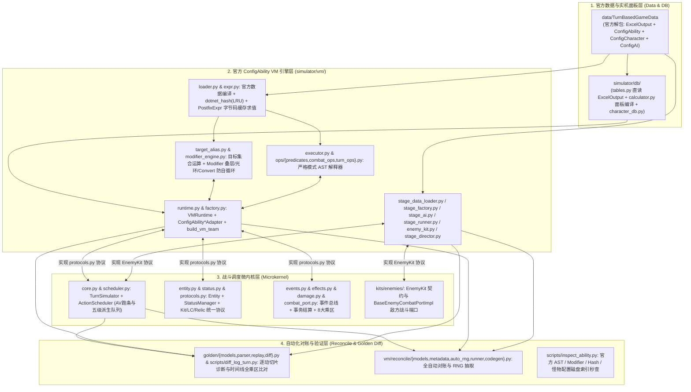
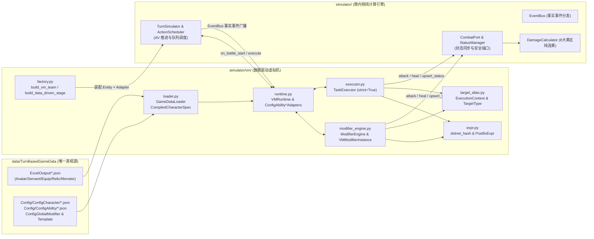

# 崩坏：星穹铁道 官方 ConfigAbility VM 战斗模拟器 (Star Rail Combat Simulator)

一个以**官方 `TurnBasedGameData` + `ConfigAbility` 纯数据驱动虚拟机 (VM)** 为核心、结合**微内核 AV 调度引擎 (`TurnSimulator`)** 与**黄金日志实机对账框架**的《崩坏：星穹铁道》回合制战斗模拟器。

> **架构主线**：角色、伴生忆灵、光锥、遗器、怪物与关卡波次/AI **100% 由官方 `data/TurnBasedGameData/` 配置与 `ExcelOutput` 数值表驱动**，零手写角色/光锥/遗器/关卡代码。实机日志全量逐动达成总伤与每动误差 **`< 0.0001%`**。
>
> 📘 **核心规范导航**：
> - **全仓研发与日志对账总纲**：[《开发与实机日志对账规范 (AGENTS.md)》](AGENTS.md)（含四大红线、五步法 SOP、四层边界、VM 算子扩展与比值数学定位法）
> - **代码索引与架构速查表**：[《代码索引与架构速查表 (CODEBASE_INDEX.md)》](CODEBASE_INDEX.md)
> - **当前活跃攻坚台账**：[《末日幻影 420564~420584 对账进度 (docs/PROGRESS_ApocalypticShadow_420564-84.md)》](docs/PROGRESS_ApocalypticShadow_420564-84.md)

---

## 🌟 四层解耦总体架构



---

## ⚙️ ConfigAbility VM 核心执行流水线



### 核心子系统职责

1. **官方配置加载与数值编译 ([`simulator/vm/loader.py`](simulator/vm/loader.py))**：
   - 直读子模块 `data/TurnBasedGameData/ExcelOutput` 与 `ConfigAbility`；
   - `compute_effective_skill_levels()` 自动按默认满级与星魂配置（E3/E5）叠加上限；
   - `resolve_avatar_dynamic_floats()` 自动解析 `DynamicValues.Floats` 中的 `SkillParam`、`SkillEquip`、`SkillRelic` 到 `{int32_hash: float}` 字典；
   - 加载期自动进行表现层节点裁剪（`PRUNABLE_PRESENTATION_TYPES`），过滤动画/相机/UI 表现节点，保留 100% 战斗逻辑。
2. **`.NET` 哈希与逆波兰公式求值器 ([`simulator/vm/expr.py`](simulator/vm/expr.py))**：
   - `dotnet_hash` 精确复现 C#/.NET 双路 5381 字符串哈希，匹配官方 `DynamicKey.Hash`；
   - `CompiledPostfixExpr` 缓存并高效求值官方逆波兰字节码，支持四则运算、比较、三元表达式与 11 种内置数学函数（`min`、`max`、`clamp`、`round` 等）。
3. **目标别名与集合代数求值器 ([`simulator/vm/target_alias.py`](simulator/vm/target_alias.py))**：
   - 支持官方所有目标别名（`Caster`、`ModifierOwnerEntity`、`AllEnemy`、`ServantEntityList` 等）；
   - 支持保序集合运算（`A + B`、`A - B`）与链式后缀（`.GetServant`、`.GetSummoner`）。
4. **Modifier 宿主与优先级调度引擎 ([`simulator/vm/modifier_engine.py`](simulator/vm/modifier_engine.py))**：
   - 生命周期管理：`ReplaceByCaster`、`Stack`、`Layer`、`ModifierPhase1End`（回合开始扣减）与 `TurnEnd`（回合结束扣减）；
   - 光环机制：自动在新实体/新波次怪入场时补发 `IsHaloStatus`；
   - 防死循环二次转化：通过 `CONVERT_PROPERTY_PAIR` 与 `StatusTag.EXCLUDE_FROM_STAT_TRANSFERS` 隔离属性二次转化；
   - 优先级严格升序：所有回调严格按 `_CallbackList.Priority` 升序触发（如 `-92 → -80 → 0`）。
5. **严格模式 AST 解释器 ([`simulator/vm/executor.py`](simulator/vm/executor.py) & `ops/`)**：
   - 默认运行在 `strict=True` 模式，杜绝未知节点静默吞错；
   - 算子分流：`predicates.py`（谓词断言）、`combat_ops.py`（伤害/治疗/护盾）、`turn_ops.py`（拉推条/召唤）、`executor.py`（控制流）。

---

## 🚀 常用命令速查

### 1. 运行测试套件

```bash
# 1. 快速回归核心单测与代表性对账 (~10s)
pytest -v

# 2. 全量对账用例回归 (含慢速关卡)
pytest -m "slow or not slow" simulator/vm/test_vm_*.py -v
```

### 2. 官方秒查工具与逐动对账

```bash
# 1. 秒查官方配置、Ability AST、Modifier 与怪物表 (底层自动维护缓存索引)
python scripts/inspect_ability.py <SymbolNameOrSubstr> --full
python scripts/inspect_ability.py --monster <MonsterID>
python scripts/inspect_ability.py --hash <HashInt>

# 2. 官方实机日志对账与时间线精准诊察
# 首次定位最早分歧点
python scripts/diff_log_turn.py battle_logs/<battle_log>.jsonl [--extra-maze-buffs <id>]

# 单动 AV 截断聚焦全乘区输出 (0.5秒输出 base/dmg%/def/res/vuln/crit/red)
python scripts/diff_log_turn.py battle_logs/<battle_log>.jsonl --av <av> --av-budget <av+1> --timeline
```

### 3. 导入个人游戏角色配装数据 (可选)

本项目支持通过 `sync_from_hoyolab.py` 自动化连接 HoYoLAB 官方战绩库，一键导出你账号的全部角色与遗器高精词条数据至 `data/character_db_export.json`：

- **方式 A（交互式弹窗登录，推荐，免滑块验证码困扰）**：
  ```bash
  python sync_from_hoyolab.py --no-headless
  ```
  弹出的 Chromium 窗口中登录一次后，Session 自动持久化至本地 `data/.hoyolab_session.json`，后续即可全自动免密运行。
- **方式 B（通过 .env 配置文件静默登录）**：
  ```bash
  cp .env.example .env  # 在 .env 中填入你的 HOYOLAB_EMAIL、HOYOLAB_PASSWORD 与 UID
  python sync_from_hoyolab.py
  ```

---

## 📁 目录结构

```
StarRail-Combat-Simulator/
├── simulator/
│   ├── vm/                             # 官方 ConfigAbility 数据驱动 VM 引擎
│   │   ├── loader.py                   #   ExcelOutput & ConfigAbility 编译与表现节点裁剪
│   │   ├── expr.py                     #   dotnet_hash (LRU) & PostfixExpr 逆波兰公式缓存求值
│   │   ├── target_alias.py             #   TargetAlias 集合代数与修饰符运算
│   │   ├── modifier_engine.py          #   Modifier 叠层/光环/Priority升序分发/Convert防自循环
│   │   ├── executor.py                 #   TaskExecutor 主调度器 (strict=True)
│   │   ├── ops/                        #   VM 算子分流 (predicates / combat_ops / turn_ops)
│   │   ├── runtime.py & factory.py     #   VMRuntime、ConfigAbility*Adapter 与 build_vm_team
│   │   ├── stage_data_loader.py        #   StageConfig / MonsterConfig 编译
│   │   ├── stage_factory.py            #   数据驱动怪物实体与 BattleEvent 工厂
│   │   ├── stage_ai.py                 #   官方 ConfigAI 决策树编译与执行器
│   │   ├── stage_runner.py             #   纯数据驱动波次/锁血/阶段切换状态机
│   │   ├── enemy_kit.py                #   DataDrivenEnemyKit (ConfigAI + ConfigAbility 敌方技能)
│   │   ├── stage_director.py           #   DataDrivenStageDirector & build_data_driven_stage
│   │   ├── stage_sim_adapter.py        #   数据驱动关卡适配器门面
│   │   └── reconcile/                  #   自动对账模块 (models / metadata / auto_rng / runner / codegen)
│   │
│   ├── core.py & scheduler.py          # AV 跑条调度微内核与五级派生队列调度器
│   ├── entity.py & status.py           # 战斗实体模型、动态属性管线与语义标签
│   ├── protocols.py                    # 统一行为处理器协议 (KitHandler / LightConeHandler / RelicSetHandler)
│   ├── combat_port.py                  # 插件安全窄接口契约
│   ├── events.py & effects.py          # 领域事实事件总线与效果事务结算
│   ├── damage.py                       # 8 大乘区纯连乘伤害计算
│   └── db/                             # 官方 ExcelOutput 数值直读 (tables.py) 与面板编译
│
├── data/
│   ├── TurnBasedGameData/              # 【Git Submodule】官方游戏配置与 Excel 数值表（唯一真相源）
│   └── character_db_export.json        # 实机导出的账号角色配置与遗器词条库
├── docs/                               # 活跃关卡对账进度台账
├── battle_logs/                        # 官方实机录制 Veritas JSONL 日志
├── scripts/                            # diff_log_turn.py & inspect_ability.py 官方秒查工具
├── AGENTS.md                           # 研发工程规范、对账四大铁律与五步法 SOP 总纲
└── CODEBASE_INDEX.md                   # 全仓代码索引与速查表
```
