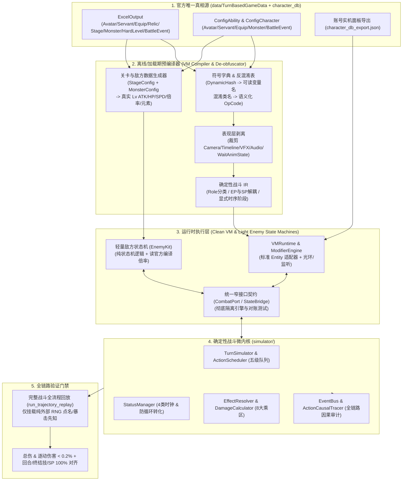

# 星穹铁道战斗模拟器 — 终极架构蓝图 (Ultimate Architecture Blueprint)

> **定位**：本文档定义本项目的**最终目标架构**、**对官方 `TurnBasedGameData` 原生设计缺陷的系统性修复方案**，以及从当前“手写/VM 并行过渡期”迈向“全数据驱动、可审计、高性能、零拟合”的演进路线图。

---

## 一、 最终目标 (End-State Vision)

打造一个**「官方真相源驱动 + 纯净确定性微内核 + 因果可审计 + 全链路实机 `< 0.2%` 门禁」**的星穹铁道战斗仿真引擎：

1. **我方资产 100% 零手写**：任意角色、伴生忆灵、光锥、遗器、星魂、行迹直接从 [`data/TurnBasedGameData/`](../data/TurnBasedGameData/) 编译加载，新角色合入子模块即可开箱仿真。
2. **关卡与敌方数值 100% 官方生成**：波次编排、等级难度系数、精英倍率、敌方六维面板、弱点抗性、技能元素与倍率全由官方 `ExcelOutput` 自动编译生成；敌方行为用轻量确定性状态机/声明式规则驱动，兼顾精准对账与自由排轴。
3. **微内核纯净且确定性**：`TurnSimulator` + `ActionScheduler` + `StatusManager` + `EffectResolver` + `DamageCalculator` 构成零角色硬编码、无动画时序污染、严格因果原子性的纯计算内核。
4. **修复官方原版设计糟粕**：在兼容官方数值语义的前提下，通过预编译 IR（中间表示）主动清理官方配置中的混淆节点、表现层耦合、命名二义性与隐式顺序陷阱。
5. **唯一权威验收方式**：直接以**完整战斗全流程**（`stage_*` + `run_trajectory_replay`，仅挂载纯外部随机点名/暴击先知）对照官方 Veritas `.jsonl` 日志，总伤与逐动误差严格 `< 0.2%`，彻底摆脱隔离沙盒下“忆灵无日志 HP 靠猜”的困境。

---

## 二、 目标架构全景图

---

## 三、 针对官方 `TurnBasedGameData` 原版设计的“排毒与重构”

在将官方配置落地到本模拟器过程中，我们实证发现了官方原生 `ConfigAbility` / `ConfigAI` 中存在大量对仿真器非常不友好的设计。**终极架构不是“盲从复刻官方源码”，而是“100% 忠实于官方数值与因果规则，同时修掉官方实现里的工程糟粕”**：

| 官方原生设计的缺陷 | 在官方文件中的具体表现 | 本蓝图的修复与重构方案 |
| :--- | :--- | :--- |
| **1. 客户端表现与动画帧强耦合** | 技能逻辑夹杂大量 `VCameraConfigChange`、`PlayTimeline`、`TriggerEffect`、并用 `WaitAnimState(NormalizedTimeEnd: 0.416 / 0.645)` 切分动作前后段 | **加载期彻底剥离 + 因果阶段编译**：保留并完善 `PRUNABLE_PRESENTATION_TYPES` 裁剪，将 `WaitAnimState` 前后的节点编译为显式因果生命周期钩子（`BeforeAction` -> `BeforeHitAll` -> `BeforeHit` -> `Hit` -> `AfterHit` -> `AfterAttack` -> `PrimaryDamageComplete` -> `ActionEnd`），与动画帧率彻底解耦。 |
| **2. 匿名 32-bit 哈希与混淆节点名** | 动态变量只存 `int32` 哈希（如 `-1126825319`）；部分核心指令以混淆类名存在（如 `BattleEventAbility_2.json` 的 `JDOLDFECMPL`、`RobinS` 里的 `GFODFDCBFJF`） | **静态反混淆符号表 + 预编译 IR**：在加载器构建全局可读字符串哈希逆向字典（覆盖全量 Config 与 Excel 字段），并将混淆指令显式注册为语义化 OpCode（如 `AddElationPoint`、`ChangeActionDelayBit`），编译为类型安全、可读可断点调试的 IR 对象，彻底消灭黑盒 `Hash`。 |
| **3. 技能分类混淆与命名二义性** | ① `SkillP01` 同时混装进场被动与主动追击（如 `1403` 的 `Avatar_Tribbie_00_Insert` 混在 `SkillP01` 导致进场误触发）； ② `ModifySPNew` 实际改的是**能量 (EP)** 而非战技点 (SP) | **编译期强制语义分离**： ① 为每条 Ability 显式标注 `AbilityRole`（`PASSIVE_INIT` / `TURN_INSERT` / `ACTIVE_SKILL` / `SERVANT_SKILL`），`OnEnterBattle` 只允许挂载 `PASSIVE_INIT`； ② 将指令拆分为显式的 `ModifyEnergy` 与 `ModifySkillPoint`，从根本上杜绝 SP/EP 混淆。 |
| **4. 隐式循环突变与快照传播不一致** | ① `HealHP(AllLightTeam)` 在循环体内逐目标立即回调 `OnAfterDealHeal`，导致站位 1~2 号位和 3~N 号位吃到不同遗器速度加成的治疗量； ② `RobinS` 的 `Point01_CritDmg` 与 `Fever_DefIgnore` 对 `HyperValue` 变化采用不同的触发刷新路径 | **显式传播图与可配置遍历语义**： ① 保留官方真实“逐目标流式副作用”（已验证实机确实如此），但在 IR 层显式标记 `per_target_streaming=True` 与编队站位契约，避免被误改成批处理； ② 建立统一的动态变量依赖图（Reactive Dependency Graph），清晰刻画“实时全局同步”与“攻击前/治疗前按目标快照”两种官方模式。 |
| **5. 敌方采用超重 DSE AI 树 + 3D 几何站位** | 官方怪使用 `DefaultDSE` 评分树、`ConsiderAxisList`、`SetSkillTargetFormationByPos` 3D 坐标编排来跑实际很简单的循环逻辑 | **“官方数据表 + 轻量确定性状态机”双层架构**： 不盲目复刻 3D 评分树；改为从 `StageConfig` + `MonsterConfig` + `HardLevelGroup` + `EliteGroup` + `MonsterSkillConfig` **自动编译生成敌方 Lv/HP/ATK(`18*AttackRatio`)/SPD/韧性/弱点/抗性/攻击元素/技能倍率**，配合简洁的 `EnemyKit` 状态机驱动 AI 顺序与转阶段。 |
| **6. 历史测试层直连角色私有属性** | `golden_diff.py`、`stage_30126122.py`、`plugins/log_*.py` 直接读写手写 Kit 的 `_heal_provider_keys`、`accumulated_healing`、`yizhi`、`vibes` | **统一窄接口与 StateBridge**：所有对账回放、日志钳位与追踪器只通过标准 `StateBridge`（如 `get_resource("memoria")`、`cast_ability(...)`）交互，完全不感知底层是 VM 还是手写 Kit。 |
| **7. 官方外部日志缺少伴生忆灵可观测字段** | Veritas `.jsonl` 不记录伴生忆灵 `CurrentHP` / `MaxHP` 与单次命中 Buff 快照，导致隔离沙盒必须靠外部规则反推忆灵掉血 | **以全战斗全流程验证为核心门禁**：以 `TurnSimulator` 原生跑通全关卡（敌方出招、忆灵掉血、波次切换、阿哈 `150/100/100` 全部引擎内生演算）+ `ActionCausalTracer` 因果报表作为主对账标准，仅保留少量纯外部 RNG 点名与暴击先知。 |

---

## 四、 分阶段演进路线图 (Roadmap)

### 阶段 1：打通“路 2”全链路外部日志验证 VM（当前正在推进）
- **目标**：我方 VM（角色 / 光锥 / 遗器）直接接入现有已校验的 `stage_30126122`（官方 Lv.95 `625.51` ATK + 官方元素与倍率底座）+ `run_trajectory_replay`，在完整战斗下用官方 `.jsonl` 日志全量验证。
- **验收标准**：
  - 建立 `simulator/vm/test_vm_30126122_alignment.py`；
  - 2 人队（`184845`、`204943`、`155925`、`184651`）-> 3 人队（`205144`、`220255`、`221208`）-> 4 人队（`222204`、`041608`）**全部达到回合/终结技/SP 100% 对齐，总伤与逐动误差 `< 0.2%`**；
  - `test_vm_phase1.py`、`test_vm_hyacine_team.py` 与旧有 `test_30126122_alignment.py` 全程无回归。

### 阶段 2：关卡与敌方数值全官方数据化（淘汰手写关卡常数）
- **目标**：扩展 `GameDataLoader`，新增 `StageDataLoader` / `MonsterDataLoader`：
  - 根据 `StageID` 自动从 `StageConfig.json`、`MonsterConfig.json`、`MonsterTemplateConfig.json`、`HardLevelGroup.json`、`EliteGroup.json`、`MonsterSkillConfig.json`、`BattleEventConfig.json` 生成波次怪物实体、属性面板、技能倍率字典与场地事件（如 `30149` 笑点与 `150/100/100` 混沌回忆节拍）；
  - 现有 `EnemyKit`（`ApoliBossKit`、`SunlitGriffinKit`、`MoonlitPegasusKit`、`MeteorEagleKit`、`BeastSproutKit`）保留干净的状态机与转阶段控制流，**全部改为读取 `MonsterSkillConfig` 编译出的官方参数**，彻底消除硬编码数字。

### 阶段 3：VM 预编译器、反混淆符号表与性能优化
- **目标**：将当前运行时直接解释原始嵌套 JSON 字典的 `TaskExecutor` 升级为 **“加载期编译为扁平 IR + 运行时直接执行”**：
  - 补全反混淆字典与 `ConfigAbility` 编译缓存（按 `TurnBasedGameData` commit hash 缓存，避免每次测试重复解析大 JSON）；
  - 消除 `golden_diff.py` / `plugins/*` 中一切手写 Kit 耦合与临时数值调整补丁；
  - 完善 `ActionCausalTracer` 对 VM `DynamicValue` 变化与 `VMModifierInstance` 层数流转的因果输出，实现任意偏差一键溯源。

### 阶段 4：全面推广与历史代码退役
- **目标**：
  - 开放任意 `AvatarID` / `LightConeID` / `RelicSetID` 零手写接入，通过 `golden-log-to-stage` 技能或 `StageDataLoader` 快速接入新混沌回忆 / 虚构叙事 / 末日幻影关卡；
  - 在全部官方实机日志均由 VM 稳定绿灯守护后，由团队决策将 `simulator/kits/characters/`、`light_cones/handlers/`、`relics/handlers/` 中已被 VM 100% 覆盖的旧手写实现归档或下线，最终收敛为极简、高可信度的核心代码库。

---

## 五、 工程红线（Architectural Guardrails）

1. **零循环自证**：严禁用实机真值反推或写死治疗池、蓄池、能量池与伤害修正表（类似历史 `_yika_adj_*` 补丁不得引入主干）。
2. **严格失败契约**：VM 遇到未实现的官方 Task / Predicate / 混淆指令必须立即抛异常暴露，禁止静默跳过。
3. **外部插件纯洁性**：`plugins/log_*.py` 仅允许注入官方随机种子决策（敌方点名、风行、概率命中、暴击先知、特定随机弹射），不得篡改战斗核心状态与计算公式。
4. **双线验证不倒退**：在手写角色 Kit 正式退役前，任何内核或公共层修改都必须保证新旧两套门禁测试不退化。
