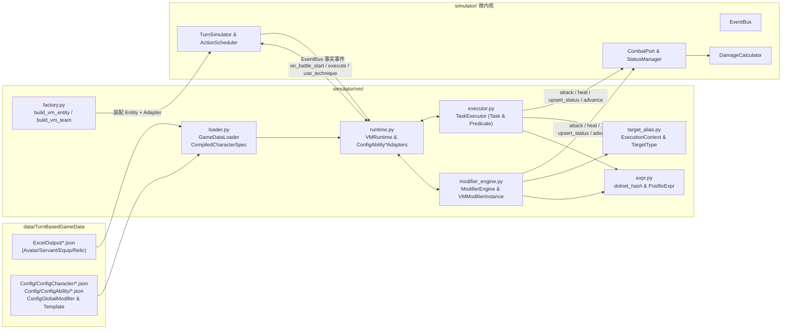

# 官方 ConfigAbility VM 引擎架构设计文档 (`simulator/vm/`)

本文档深入说明本项目引入的**官方 `ConfigAbility` 数据驱动虚拟机（Official ConfigAbility VM）**的内部结构、执行流水线、与 `TurnSimulator` 微内核的边界契约，以及后续基于 VM 推进全角色/光锥/遗器与关卡对账的演进路线。

---

## 1. 引入背景与架构定位

早期模拟器通过手写 Python 类（`simulator/kits/characters/`、`light_cones/handlers/`、`relics/handlers/`）复刻技能逻辑，存在**倍率分散、事件优先级靠人工猜测、机制联动容易出现二义性**等维护成本。

引入 [`simulator/vm/`](../simulator/vm/) 后，项目切换为 **「官方数据驱动 VM + 轻量化 AV 调度微内核」** 架构：
- **所有角色、伴生忆灵、光锥、遗器的机制与数值**直接来源于挂载在 [`data/TurnBasedGameData/`](../data/TurnBasedGameData/) 的官方配置与 `ExcelOutput` 数值表；
- **微内核 (`TurnSimulator` / `ActionScheduler` / `StatusManager` / `DamageCalculator`)** 保持职责纯净，仅负责跑条、五级队列调度、状态属性汇算、伤害乘区计算与不可变事件广播；
- **VM 层通过标准适配器协议 (`ConfigAbilityKitAdapter`, `ConfigAbilityLightConeAdapter`, `ConfigAbilityRelicAdapter`)** 挂载到实体上，对微内核完全透明，并支持与手写兼容层或独立敌方套件 (`simulator/kits/enemies/`) 同场混跑。

---

## 2. 模块拓扑与数据流

---

## 3. 核心子系统详解

### 3.1 配置加载与数值编译器 ([`simulator/vm/loader.py`](../simulator/vm/loader.py))

1. **数据源路径解析**：优先使用仓库子模块 `data/TurnBasedGameData`（检测到其下存在 `ExcelOutput/` 目录时生效），否则回退 `/tmp/tbgd`（由 `DEFAULT_TBGD_ROOT` 控制）。
2. **Excel 数值表按需索引**：
   - 角色与伴生忆灵：`AvatarConfig`、`AvatarSkillConfig`、`AvatarSkillTreeConfig`、`AvatarRankConfig`、`AvatarServantConfig`、`AvatarServantSkillConfig`；
   - 装备与敌方：`EquipmentConfig`、`EquipmentSkillConfig`、`RelicSetSkillConfig`、`MonsterConfig`、`MonsterSkillConfig`。
3. **有效技能等级与 `ReadInfo` 编译**：
   - `compute_effective_skill_levels()` 自动按默认养成满级（普攻/忆灵技 6 级、战技/终结技/天赋 10 级、秘技 1 级）并叠加 `AvatarRankConfig.SkillAddLevelList`（E3/E5 技能等级 +1/+2）；
   - `resolve_avatar_dynamic_floats()`、`resolve_servant_dynamic_floats()`、`resolve_ability_dynamic_floats()` 自动解析 `DynamicValues.Floats` 中的 `SkillParam`、`SkillRank`、`SkillTreeParam`、`SkillEquip`、`SkillRelic` 到 `{int32_hash: float}` 字典，输出 `CompiledCharacterSpec`。
4. **加载期 AST 表现节点裁剪 (`prune_ability`)**：
   - 通过 `PRUNABLE_PRESENTATION_TYPES`（100+ 相机、动画、特效、音效、UI 类节点）与 `*ClientOnly` 后缀过滤，安全裁剪纯客户端表现节点，保留 100% 战斗逻辑分支与回调。

### 3.2 `.NET` 哈希与 `PostfixExpr` 字节码求值器 ([`simulator/vm/expr.py`](../simulator/vm/expr.py))

1. **`dotnet_hash(s)`**：精确复现 C#/.NET Core 双路 5381 交错字符串哈希算法，返回有符号 32 位整数，用于匹配官方 `DynamicKey.Hash`、`TriggerKey.Hash` 与内置函数名。
2. **`CompiledPostfixExpr` / `eval_compiled_expr`**：
   - 同时兼容**现代字节码**（结尾操作码 `17`，支持四则运算、取模、比较 `Eq/Gt/Ge/Lt/Le`、三元表达式 `Ternary`、取负 `Neg`、`Call(argc)`）与**早期字节码**（结尾操作码 `10`，如部分早期遗器配置中的 `OpCodes`）；
   - 完整实现官方全部 11 个内置数学函数：`min`、`max`、`clamp`、`clamp01`、`floor`、`ceil`、`round`、`abs`、`pow`、`int`、`mod`。
3. **`eval_dynamic_float()`**：统一处理 `PostfixExpr`（动态公式）、`FixedValue`、`Value` 与裸浮点常数。

### 3.3 目标别名与集合代数求值器 ([`simulator/vm/target_alias.py`](../simulator/vm/target_alias.py))

- **`ExecutionContext`**：承载一次执行上下文中的 `caster_id`、`ability_name`、`modifier_owner_id`、`modifier_instance`、`ability_target_ids`、`skill_target_ids`、`attack_target_ids`、`param_entity_id`、`param_entity2_id`、`local_dynamics`、`damage_data`、`heal_data`、`change_value` 等作用域字段。
- **`resolve_target_alias()`**：
  - 支持全部原子锚点（`Caster`、`ModifierOwnerEntity`、`CasterSummoner`、`CasterServant`、`ParamEntity`、`AbilityTargetEntity`、`AbilityTargetAdjoinEntity`、`AllLightTeam`、`AllEnemy`、`ServantEntityList`、`LevelEntity` 及动态命名目标等）；
  - 支持保序并/差集运算（`A + B`、`A - B`）；
  - 支持链式后缀修饰符（`.GetServant`、`.GetSummoner`、`.RemoveBattleEvent`、`.RemoveServant`、`.WithBattleEvent`、`.GetActualOwner`、`.GetDummyCharacter`）。
- **`resolve_target_type()`**：支持纯字符串别名、`TargetAlias`、`TargetConcat`、`TargetFetchPartner`、`TargetSequence`。

### 3.4 Modifier 宿主与优先级调度引擎 ([`simulator/vm/modifier_engine.py`](../simulator/vm/modifier_engine.py))

1. **`VMModifierInstance` 生命周期管理**：
   - 支持 `Stacking`（`ReplaceByCaster`、`Replace`、`Refresh`、`Unique`、`Stack`）、`Layer` / `MaxLayer`、`LifeTime` / `LifeStepMoment`（区分 `ModifierPhase1End` 与 `TurnEnd` 两类扣减时机）、`BehaviorFlagList` 与 `OnCreate` / `OnStack` / `OnDestroy` 回调。
   - 级联派生与光环：支持 `AdditionConfig.SubModifierList` 与 `IsHaloStatus` 标记；当新实体（伴生忆灵或新波次敌方）入场时，通过 `on_entity_created()` / `attach_halos_to_new_entity()` 自动补发存活光环并分发 `OnListenCharacterCreate`。
2. **微内核 `StatusManager` 双向同步与防自循环**：
   - 通过 `PROPERTY_TO_STAT` 将 `StackProperty` 与静态 `Properties` 实时同步为 `BuffSpec` 写入 `TurnSimulator.port.upsert_status()`，从而直接被 `Entity` 与 `DamageCalculator` 读取；
   - 通过 `CONVERT_PROPERTY_PAIR` 追踪 `*Convert` 转化类属性（`SpeedConvert`、`CriticalDamageConvert`、`HPConvert`、`HealRatioConvert`），自动打上 `StatusTag.EXCLUDE_FROM_STAT_TRANSFERS`，同时支持 `get_entity_property()` 分别读取总量与转化量，避免二次转化递归膨胀。
3. **严格 `Priority` 升序事件调度**：
   - `dispatch_event()` 收集所有匹配事件名的 `_CallbackList` 条目，严格按 `(Priority, _spawn_order)` 升序执行（例如 `-92` 先于 `-80` 先于 `0`）。
4. **范围阈值监听器**：
   - 完整实现 `OnAbilityPropertyChange`（如风堇速度 > 200 激活暴风停歇）与 `OnDynamicValueChange`（如晴歌状态值变化）的 `OnEnterRange` / `OnChange` / `OnExitRange` 触发，并在 `add_modifier` / `stack_property` 期间使用 `_apc_defer_depth` 延迟批处理，避免中间态抖动。

### 3.5 AST Task & Predicate 解释器 ([`simulator/vm/executor.py`](../simulator/vm/executor.py))

- **严格失败契约 (`strict=True`)**：遇到尚未实现的逻辑 `Task` 或 `Predicate` `$type` 直接抛出 `NotImplementedError`，防止静默漏结算导致隐蔽对账漂移。
- **已覆盖核心指令集**：
  - **控制流与模板**：`PredicateTaskList`、`SwitchCaseByDynamicValue`、`ConditionLoopExecuteTaskList`（带安全循环上限）、`IncludeTaskListTemplate`、`TriggerParallelTaskListTemplate`、`TriggerAbility`、`TriggerParallelAbility`、`Retarget`、`FireProjectile`；
  - **动态变量操作**：`SetDynamicValue`、`SetDynamicValueByAddValue`、`SetDynamicValueByProperty`、`SetDynamicValueByCopying`、`SetDynamicValueByModifierValue`、`SetDynamicValueByCharacterCount`、`SetDynamicValueByHealDataProperty`、`SetDynamicValueByDamageDataProperty`、`SetDynamicValueByAttackTargetCount`、`SetDynamicValueByVariateType`、`SetModifierDynamicValue`、`SetModifierValue`；
  - **状态与属性**：`AddModifier`、`RemoveModifier`、`RemoveSelfModifier`、`RemoveModifierByBehaviorFlag`、`StackProperty`、`DispelStatus`；
  - **战斗结算与行动轴**：`HealHP`（完整驱动 `OnBeforeDealHeal` / `OnBeforeBeingHeal` / `ModifyHealData` / `OnAfterDealHeal`）、`DamageByAttackProperty`（驱动 `OnAttackerPrepareAttackData` / `OnBeforeAttack` / `OnBeforeHitAll` / `ModifyDamageData` / `OnAfterHitAll` / `OnAfterAttack` 并将临时乘区注入 `CombatPort.attack`）、`LoseHPByRatio`、`ModifySPNew`、`ModifyActionDelay`、`ResetActionDelay`、`SetActionDelay`、`TurnInsertAbility` / `TurnInsertAbilityCondition` / `TurnInsertAction`、`CreateServant`、`ForceKill`。

### 3.6 运行时协调器、适配器与装配工厂 ([`simulator/vm/runtime.py`](../simulator/vm/runtime.py), [`simulator/vm/factory.py`](../simulator/vm/factory.py))

1. **`VMRuntime`**：
   - 单例式挂载在 `sim.vm_runtime`（通过 `ensure_vm_runtime(sim)` 获取）；
   - 订阅 `TurnSimulator.event_bus` 的 `TurnBeginEvent`、`TurnEndEvent`、`ActionExecuteEvent`、`ActionEndEvent`、`HPLostEvent`，转换为官方事件（`OnListenTurnBegin`、`OnActionPhaseBegin`、`OnBeforeSkillUse`、`OnAfterSkillUse`、`OnListenHPChange`、`CheckParamFlagCallBack` 等）；
   - `TurnSimulator.__init__` 在所有实体 `on_battle_start()` 之后自动调用 `sim.vm_runtime.enter_battle()`，按全局优先级触发 `OnEnterBattle` 并刷新进场属性区间。
2. **标准适配器**：
   - `ConfigAbilityKitAdapter(KitHandler)`：驱动角色本体与忆灵（`Skill01`/`Skill02`/`Skill03`/`SkillMaze`/`SkillP*`），并自动读取 `ExcelOutput` 的 `SPBase` 结算回能；
   - `ConfigAbilityLightConeAdapter(LightConeHandler)`：加载并触发 `EquipmentSkillConfig` 对应的 `Ability`；
   - `ConfigAbilityRelicAdapter(RelicSetHandler)`：加载并触发 `RelicSetSkillConfig` 对应的 2/4 件套 `Ability`。
3. **实体装配工厂 (`factory.py`)**：
   - 提供 `build_vm_entity()` 与 `build_vm_team()`，将 `data/character_db_export.json` 中的实机白字/遗器词条面板转换为挂载 VM 适配器的 `Entity`；
   - **面板去重规范**：由于导出面板 `character_db_export.json` 常已把部分行迹/内圈常驻词条烘焙进基础属性（如风堇 `PointB1` +100% 暴击与内圈 320 +20% 治疗、拾骨地 319 +28% 暴伤），而 VM 进场/局内会主动重新施加这些官方 Modifier，因此 `build_vm_entity()` 会精确扣除已预烘焙的重复项。

---

## 4. 对账沙盒与未来演进路线

### 4.1 已有验证与沙盒

- **基础测试** ([`simulator/vm/test_vm_phase1.py`](../simulator/vm/test_vm_phase1.py), [`simulator/vm/test_vm_hyacine_team.py`](../simulator/vm/test_vm_hyacine_team.py))：覆盖 `.NET` 哈希、`PostfixExpr`、1403/1409/1413/1512 数值表对齐、以及进场 Priority / 召唤 / 治疗 / 遗器光环联动。
- **黄金日志 VM 逐动沙盒** ([`simulator/vm/vm_reconciliation.py`](../simulator/vm/vm_reconciliation.py))：`VMReconciliationHarness` 继承自 `FixedReconciliationHarness`，使用全 VM 队伍直接对接 5 份实机 `battle_logs/battle_*.jsonl` 进行逐动对账。

### 4.2 后续演进方向

1. **角色与装备全面 VM 化**：新接入角色、光锥、遗器优先通过 `ConfigAbility*Adapter` 接入，遇到未覆盖的官方 `$type` 节点或 `TargetAlias` 时，按官方语义补全 `executor.py` / `target_alias.py` / `modifier_engine.py`，使所有同类型机制受益。
2. **关卡 30126122 全轨迹 VM 切换**：在 `VMReconciliationHarness` 与 `test_30126122_alignment.py` 中进一步收敛全部单动至 `< 0.2%`，并逐步将 `simulate_battle.py` / `query_turn_action.py` 的默认装配管线切向 `factory.py` / VM 模式。
3. **敌方配置化扩展评估**：当前敌方技能套件位于 [`simulator/kits/enemies/`](../simulator/kits/enemies/)（保持与我方 VM 解耦）；未来可按需引入 `MonsterConfig` 驱动的敌方能力加载，同时维持与 `StageDirector` 和 `golden_diff.py` 的严格边界隔离。
