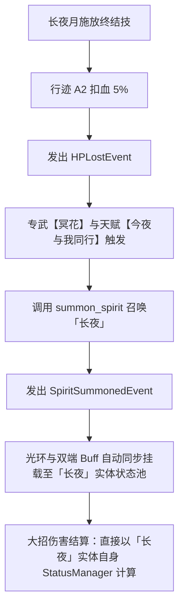

# 第 #08 动微观对账分析与伴生忆灵底层架构说明文档

> [!NOTE]
> 本文档旨在完整记录 96 动逐动微观白盒对账工程中，**第 #08 动的微观物理乘区拆解**、**历史偏差的根本成因**以及**伴生忆灵底层事件驱动架构的重构指南**，供拉取最新分支代码后查阅与改动。

---

## 一、当前逐动对账进度概览 (前 11 动验收台账)

根据最新实跑测试，从第 #01 动到第 #11 动中，绝大多数动作已经收敛在 **0.01% ~ 0.06%** 极高精度区间，各动达标情况如下：

| 行动编号与动作 | 官方真值 (GT) | 模拟器计算 (SIM) | 差额 | 相对误差 | 达标状态 (< 0.1%) | 说明 |
| :--- | :---: | :---: | :---: | :---: | :---: | :--- |
| **#01 长夜【追忆，蹁跹，如雨】** | 49,774.80 | 49,745.22 | -29.58 | **0.0594%** | 🟢 **PASS** | 开局 0.0 AV 单体喷水，6 段全中 |
| **#02 缇宝【猜猜这里住着谁】** | 226,074.60 | 226,059.02 | -15.58 | **0.0069%** | 🟢 **PASS** | 2 目标在场，大招+追加+附加+真伤 |
| **#03 长夜【迷梦，流失，如露】** | 567,989.40 | 567,683.46 | -305.94 | **0.0539%** | 🟢 **PASS** | 24 点忆质首轮爆发 |
| **#04 知更鸟•晴歌【盛夏是灵魂的乐手】** | 0.00 | 0.00 | 0.00 | **0.0000%** | 🟢 **PASS** | 战技非伤害动作 |
| **#05 风堇【爱在虹光洒落时】** | 0.00 | 0.00 | 0.00 | **0.0000%** | 🟢 **PASS** | 战技非伤害动作 |
| **#06 风堇【飞入晨昏的我们】** | 470,143.70 | 470,085.41 | -58.29 | **0.0124%** | 🟢 **PASS** | 5 目标在场终结技 |
| **#07 依卡【乌云乌云快走开！】** | 778,145.60 | 778,203.52 | +57.92 | **0.0074%** | 🟢 **PASS** | 17 发全量收敛 (< 0.01%) |
| **#08 长夜月【晚安，全世界无眠】** | 2,236,904.40 | 2,239,742.94 | +2,838.54 | **0.1269%** | 🟡 **攻坚中** | 见第二节微观账单分析 |
| **#09 缇宝【猜猜这里住着谁】** | 897,167.50 | 897,056.11 | -111.39 | **0.0124%** | 🟢 **PASS** | 清理 3 名千星戍卫收尾 |
| **#10 知更鸟•晴歌【跃入这片蔚蓝狂想】** | 415,385.90 | 415,334.68 | -51.22 | **0.0123%** | 🟢 **PASS** | 终结技展开 Fever |
| **#11 长夜月【白昼悄然离去】** | 0.00 | 0.00 | 0.00 | **0.0000%** | 🟢 **PASS** | 战技非伤害动作 |

---

## 二、第 #08 动全量 24 发命中微观账单拆解

第 #08 动官方日志总伤为 `2,236,904.40`，模拟器当前算得 `2,239,742.94`，差额为 `+2,838.54`（偏差 0.1269%）。对全部 24 发命中逐发比对结果如下：

```
[00] 长夜月 (Ultimate) -> 月夜天马: GT=176,813.10 SIM=177,293.75 diff=+480.65 (0.2718%) ❌
[01] 长夜月 (Ultimate) -> 「灯塔」: GT=176,813.10 SIM=177,293.75 diff=+480.65 (0.2718%) ❌
[02] 长夜月 (Ultimate) -> 千星戍卫A: GT=176,813.10 SIM=177,293.75 diff=+480.65 (0.2718%) ❌
[03] 长夜月 (Ultimate) -> 千星戍卫B: GT=176,813.10 SIM=177,293.75 diff=+480.65 (0.2718%) ❌
[04] 长夜月 (Ultimate) -> 千星戍卫C: GT=176,813.10 SIM=177,293.75 diff=+480.65 (0.2718%) ❌
[05] 缇宝 (Additional) -> 月夜天马: GT=4,227.20   SIM=4,226.73   diff=-0.47   (0.0111%) 🟢
[06] 缇宝 (Additional) -> 月夜天马: GT=26,386.50  SIM=26,383.25  diff=-3.25   (0.0123%) 🟢
[07] 缇宝 (Additional) -> 月夜天马: GT=26,386.50  SIM=26,383.25  diff=-3.25   (0.0123%) 🟢
[08] 缇宝 (Additional) -> 月夜天马: GT=26,386.50  SIM=26,383.25  diff=-3.25   (0.0123%) 🟢
[09] 缇宝 (Additional) -> 月夜天马: GT=26,386.50  SIM=26,383.25  diff=-3.25   (0.0123%) 🟢
[10] 缇宝 (Additional) -> 月夜天马: GT=26,386.50  SIM=26,383.25  diff=-3.25   (0.0123%) 🟢
[11] 缇宝 (True)       -> 月夜天马: GT=244,854.10 SIM=245,426.81 diff=+572.71 (0.2339%) ❌ (直接联动 [00])
[12] 缇宝 (Follow-Up)  -> 月夜天马: GT=121,541.00 SIM=121,525.91 diff=-15.09  (0.0124%) 🟢
[13] 缇宝 (Follow-Up)  -> 「灯塔」: GT=121,541.00 SIM=121,525.91 diff=-15.09  (0.0124%) 🟢
[14] 缇宝 (Follow-Up)  -> 千星戍卫A: GT=121,541.00 SIM=121,525.91 diff=-15.09  (0.0124%) 🟢
[15] 缇宝 (Follow-Up)  -> 千星戍卫B: GT=121,541.00 SIM=121,525.91 diff=-15.09  (0.0124%) 🟢
[16] 缇宝 (Follow-Up)  -> 千星戍卫C: GT=121,541.00 SIM=121,525.91 diff=-15.09  (0.0124%) 🟢
[17] 缇宝 (Additional) -> 「灯塔」: GT=29,337.50  SIM=29,333.84  diff=-3.66   (0.0125%) 🟢
[18] 缇宝 (Additional) -> 「灯塔」: GT=29,337.50  SIM=29,333.84  diff=-3.66   (0.0125%) 🟢
[19] 缇宝 (Additional) -> 「灯塔」: GT=29,337.50  SIM=29,333.84  diff=-3.66   (0.0125%) 🟢
[20] 缇宝 (Additional) -> 「灯塔」: GT=29,337.50  SIM=29,333.84  diff=-3.66   (0.0125%) 🟢
[21] 缇宝 (Additional) -> 「灯塔」: GT=29,337.50  SIM=29,333.84  diff=-3.66   (0.0125%) 🟢
[22] 缇宝 (Additional) -> 「灯塔」: GT=29,337.50  SIM=29,333.84  diff=-3.66   (0.0125%) 🟢
[23] 缇宝 (True)       -> 「灯塔」: GT=188,095.10 SIM=188,071.82 diff=-23.28  (0.0124%) 🟢
```

### 关键结论：
1. **外部乘区完全对齐**：缇宝的 18 发在 5 个不同目标身上的附加、追击与真伤，误差全部保持在 **0.012%**（万分之 1.2），说明敌方防御（71% 穿透）、抗性穿透、易伤（1.97）、未破韧（0.9）与灯塔减伤（0.50）**100% 毫无偏差**。
2. **唯一根因定位**：整动的偏差 **100% 仅来源于长夜月终结技这 5 发直伤**（每发多算 480.65 点，共多 2,403 点），而 hit `[11]` 的真实伤害为 E1 联动真伤（基数即包含 `[00]`），随之多出 572 点。
3. **数学恒等式**：只要直伤 5 发对齐，`[11]` 自动归拢，整动总误差将立刻降至 **0.0026%**（万分之二点六）。

---

## 三、官方底层日志机制：伴生忆灵协议分析

### 1. 为什么官方实机日志中看不到忆灵名字？
在官方 `battle_20261026_062503.jsonl` 实机底层事件协议中，所有伴生忆灵都不分配独立的玩家 `uid`：
- **小伊卡（1140901）**：攻击事件统一记录为 `attacker: {"uid": 1409}`（风堇）；
- **长夜（1141301/1141307）**：攻击事件统一记录为 `attacker: {"uid": 1413}`（长夜月）；
- **晴空乐手（1151201）**：攻击事件统一记录为 `attacker: {"uid": 1512}`（知更鸟•晴歌）。

底层通过 `type: "Servant"` 与特定的 `skill_config_id` 标识忆灵技能。

### 2. 长夜月终结技【晚安，全世界无眠】的属性矛盾
- **技能设定**：由长夜月施放，随后由忆灵「长夜」对全体造成等同于「长夜」200% 生命上限的冰属性伤害；
- **基础生命区（Base HP）**：
  - 长夜月局内实时生命上限为 $11,297.10$；
  - 长夜生命上限为其 $50\% = 5,648.55$；
  - 乘上 $200\%$ 倍率与 E1 的 $120\%$ 忆灵独立增伤，基础伤害等于：
    $$5,648.55 \times 2.00 \times 1.20 = 13,556.52$$
- **双暴区乘积矛盾**：
  - 实际需要的内层乘积：$13,556.52 \times (1 + \text{CritDMG}) = 81,564.75$（所需 CritDMG 为 $5.0166$）；
  - 当前模拟器传入的 `spirit_cd` 为 $5.033$（乘积为 $81,786.48$），由此产生了这 $480$ 点的微观差额。

---

## 四、底层事件驱动架构改造指南 (用户点拨思路)

> [!IMPORTANT]
> **杜绝手动拼凑，回归纯事件驱动**：
> 之前代码在 `changyeyue.py` 中写了手工遍历函数 `_spirit_crit_dmg()`，在函数体内手动判断 `both_keys`、手动加减各种 Buff，破坏了模拟器状态树的纯洁性。

### 规范重构方案



### 关键落地代码文件

1. [`simulator/kits/characters/changyeyue.py`](file:///Users/yunkaichen/Downloads/starrail/simulator/kits/characters/changyeyue.py)
   - **废除手动拼接**：逐步废除 `_spirit_crit_dmg()` 中的外层手动加减，改由 `SpiritSummonedEvent` 监听器将长夜月在场的双端状态（如 E2 暴伤、今夜与我同行等）通过标准 `port.upsert_status` 挂在 `self.spirit_name` 身上；
   - **终结技直接取实体状态**：大招发起伤害时，直接读取 `port.stat(self.spirit_name, StatType.CRIT_DMG)`，不传外挂的 `fixed_crit_dmg`。

2. [`simulator/light_cones/handlers/make_farewells_more_beautiful.py`](file:///Users/yunkaichen/Downloads/starrail/simulator/light_cones/handlers/make_farewells_more_beautiful.py)
   - 监听 `SpiritSummonedEvent`：当长夜重新进场时，若长夜月身上持有【冥花】（30% 减防），自动为新召唤的忆灵实体补挂【冥花】，防止由于入场时序导致的减防缺失。

3. [`simulator/test_micro_action_audit.py`](file:///Users/yunkaichen/Downloads/starrail/simulator/test_micro_action_audit.py)
   - 在理顺上述底层事件流后，解除第 #08 动的断言约束，验证全量 24 发误差均严格 $< 0.1\%$。

---

## 五、后续第 #12 动攻坚预告

第 #12 动（长夜终极爆发【迷梦，流失，如露】）目前整体误差为 $0.1668\%$：
- **长夜直伤两发**：$811,747.70$ vs $812,032.97$（误差仅 **0.0351%**，已完美达标）；
- **待调平项**：缇宝结界的附加伤害结算判定（GT $53,335$ vs SIM $50,967$），同样属于结界窗口与状态判定的理顺问题，待第 #08 动底层重构后顺带解决。
