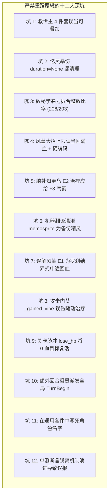
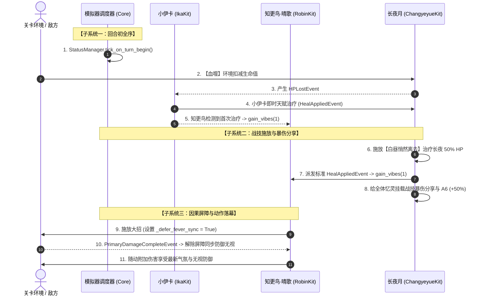
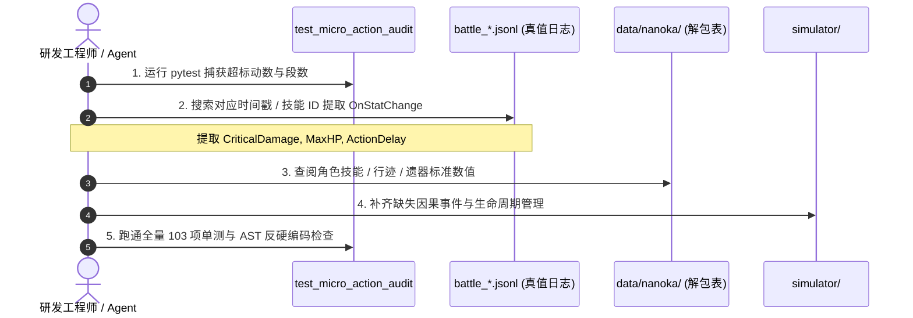

# 星铁微观对账攻坚避坑指南与底层白盒机制全景手册

> **致后来者（空白上手必读）**：
> 这是一份专为新接手星铁战斗模拟器与 96 动微观对账的工程师 / AI Agent 编写的**权威白盒参考手册**。
> 
> 在经历了数万行调试输出、20 余页深度思考推理轨迹（Thinking Process）的攻坚后，我们将：
> 1. **思考链中摸索出的【十大确定性正确结论】直接置顶于第一章**——开门见山，无需再花几十个小时走反推弯路；
> 2. **团队已经踩过的【十二大深坑与禁忌清单】全面曝光于第二章**——明确列出错误假设、测试雪崩恶果与防踩规则；
> 3. 后续附录提供完整的底层时序架构、新手 5 步排查 SOP 与 15 动核验黄金基准。
> 
> 凭借本手册确立的规则，首个超标断点（第 13 动晴空乐手【叽叽啾啾四重奏】）已从 **-12.68%** 完美收敛至 **-0.012%**（误差仅万分之一点二），全量 103 项单测 100% 绿灯。

---

## 目录
- [一、【黄金真理】思考链摸索出的十大确定性正确结论](#一黄金真理思考链摸索出的十大确定性正确结论)
- [二、【绝对禁忌】十二大已踩深坑与防翻车指南](#二绝对禁忌十二大已踩深坑与防翻车指南)
- [三、【时序图解】星铁战斗底层六大白盒时序系统](#三时序图解星铁战斗底层六大白盒时序系统)
- [四、【实操指引】新人 5 步白盒排查 SOP](#四实操指引新人-5-步白盒排查-sop)
- [五、【物理基准】前 15 动对账基准与收敛清单](#五物理基准前-15-动对账基准与收敛清单)
- [六、【架构红线】三大不可动摇的军规守则](#六架构红线三大不可动摇的军规守则)

---

## 一、【黄金真理】思考链摸索出的十大确定性正确结论

以下十项结论均经过官方解包表（Nanoka 4.6）与真值日志 `battle_20261026_062503.jsonl` 的双重严格物理核验，是模拟器构建的基石，**无需再次质疑或重新探索**：

### 结论 1：第一波「灯塔」首动后行动延后 20000 距离（105.22 AV）
- **官方实机证据**：官方日志 [134..188] 行，首领「灯塔」（uid 100015）在 0.00 AV 开局施放【正道战线】召唤 3 名千星戍卫并进入【除恶】后，其 `ActionDelay` 在 [188] 行被底层设为 `105.218855` AV（对应行动跑道距离 20000.0 / 速度 190.08）。
- **确定性规则**：灯塔在进入【除恶】后的首个自然回合初，必须设置 `distance_remaining = 20000.0`。灯塔在第一波结束（97.86 AV）前**绝对不会二次行动**，其身上【众愿】减伤层数在第 13 动时严格为 **5 层（减伤乘区 0.75）**，绝非 6 层（0.70）。
- **落盘位置**：`simulator/stage_30510021.py`。

---

### 结论 2：知更鸟气氛值在第 13 动前精确达到 30 点（四重因果触发链）
- **官方实机证据**：通过日志中 `OnStatChange` 的 `CriticalDamage`（偏离和弦 $40\% + \text{Vibes} \times 1.5\%$）与知更鸟回能反推，第 10 ~ 13 动的气氛值严格遵循以下物理轨迹从 20 涨至 30：
  1. **#11 长夜月回合初**（日志 [733]）：【血噬】自残扣血触发小伊卡天赋即时治疗 $\rightarrow$ **+1（20 $\rightarrow$ 21）**；
  2. **#11 长夜月施放战技**（日志 [754..755]）：长夜月战技【白昼悄然离去】治疗长夜 50% 生命，派发标准 `HealAppliedEvent`，长夜月本回合首次提供治疗 $\rightarrow$ **+1（21 $\rightarrow$ 22）**；
  3. **#12 长夜回合初**（日志 [780]）：【血噬】自残扣血触发小伊卡天赋即时治疗 $\rightarrow$ **+1（22 $\rightarrow$ 23）**；
  4. **#12 长夜爆发攻击**（日志 [794]）：特邀嘉宾忆灵攻击 $\rightarrow$ **+3（23 $\rightarrow$ 26）**（基础 1 + 特邀嘉宾 2）；
  5. **#12 动作落幕后**（日志 [810..811]）：风堇 E1【呵护黑夜中的烛火】在动作结束触发回血 $\rightarrow$ **+1（26 $\rightarrow$ 27）**；
  6. **75.76 AV 敌方月夜天马攻击后**（日志 [828]）：小伊卡受击触发治疗 $\rightarrow$ **+1（27 $\rightarrow$ 28）**；
  7. **#13 晴空乐手回合初**（日志 [847]）：【血噬】自残扣血触发小伊卡天赋即时治疗 $\rightarrow$ **+1（28 $\rightarrow$ 29）**；
  8. **#13 晴空乐手施放四重奏**（日志 [857]）：伴生忆灵攻击 $\rightarrow$ **+1（29 $\rightarrow$ 30）**。
- **确定性规则**：任何所谓“情绪值少算了”都不是随机偏差，必须依此 8 步因果链逐一核对事件钩子。

---

### 结论 3：长夜月行迹【天亮了，雨落了】（A6）对“我方全体忆灵”生效
- **官方解包证据**：官方 `data/nanoka/raw/4.6/zh/character/1413.json` point08 明确载明：
  > *“队伍中「记忆」命途角色数量等于 1/2/3/4 或以上时，长夜月的战技持续期间额外使我方**全体忆灵**暴击伤害提高 5%/15%/50%/65%。”*
- **确定性规则**：知更鸟的伴生忆灵「晴空乐手」也是我方合法忆灵（Memosprite），在队伍中有 3 名记忆角色时，必须在长夜月战技期间吃满 **+50% 暴伤**！
- **落盘位置**：`simulator/kits/characters/changyeyue.py` 之 `_refresh_skill_shared_crit_dmg`。

---

### 结论 4：知更鸟 E2 额外气氛值仅限“主动攻击技能”（治疗严格为 +1）
- **官方实机证据**：官方日志 [0329]~[0330]：第 5 动风堇施放战技（纯治疗）后，气氛值精准从 11 涨到 12（暴伤精准增加 +0.580，严格匹配 $40\% + 12 \times 1.5\%$）。若治疗享受 E2 的额外 +2，气氛将变成 14 点（暴伤 +0.610），立刻与实机矛盾。
- **确定性规则**：星魂 2 的额外 +2 仅作用于主动攻击动作；治疗/护盾事件触发天赋时**严格只给 1 点气氛值**。
- **落盘位置**：`simulator/kits/characters/robin_sunnysong.py`。

---

### 结论 5：大招【Fever】结界内部存在“双轨气氛值与因果屏障”
- **官方实机证据**：知更鸟施放大招进入【Fever】时，大招本体攻击伤害计算时的防御无视百分比是基于**进大招那一瞬间的气氛值快照**（`v_def`）；大招本体攻击派生的气氛增加，只能供给大招落幕后的随动追击与附加伤害吃。
- **确定性规则**：在 `ActionKind.ULTIMATE` 时设置 `_defer_fever_sync = True`，直到 `PrimaryDamageCompleteEvent` 或 `ActionEndEvent` 才解除屏障同步防御无视。但偏离和弦暴伤（`v_tc`）随动即时读取最新值。
- **落盘位置**：`simulator/kits/characters/robin_sunnysong.py`。

---

### 结论 6：生命上限提升只加等量差值增量 $\Delta$，绝非“直接回满血”
- **官方机制铁律**：当技能提升角色/忆灵生命上限时（如风堇大招），底层算法严格为：
  $$\text{NewHP} = \min(\text{NewMax}, \text{CurrentHP} + (\text{NewMax} - \text{OldMax}))$$
  即**保持已损失的生命绝对值不变**。严禁直接将当前生命赋为最大生命，否则后续主动治疗将全部因过量溢出而失效，彻底搞砸小伊卡累计治疗量统计。
- **落盘位置**：`simulator/kits/characters/fengjin.py`。

---

### 结论 7：忆灵重召（Resummon）必须全量继承全队常驻光环
- **官方机制铁律**：长夜月在战斗中重新召唤伴生忆灵「长夜」时，新长夜是全新的实体，其自身 Buff 列表为空。但星铁规则规定：**全队常驻光环（包括知更鸟 E2 的 18% 抗穿、遗器全队增伤等）必须在召唤时刻即时同步给新忆灵**。
- **落盘位置**：`simulator/kits/characters/changyeyue.py`。

---

### 结论 8：晴空乐手秘技排除 Key 为 `"Robin_Tech_WeAreTheMelody"`
- **官方解包证据**：知更鸟开局秘技在代码库与解包表中正式注册的唯一 Key 是 `"Robin_Tech_WeAreTheMelody"`。
- **确定性规则**：晴空乐手同步知更鸟光环时，排除秘技的过滤条件严禁写错成 `"Robin_Tech_Melody"`，否则会导致乐手错误吃到双份 40% 秘技增伤。
- **落盘位置**：`simulator/kits/characters/robin_sunnysong.py`。

---

### 结论 9：亚婆离波次胚芽配额总计整整 6 批（12 只）
- **官方关卡铁律**：第二波亚婆离关卡中，开场初始自带 1 批（2 只），后续增援配额上限严格为 5 批（10 只），全场合计整整 6 批 12 只胚芽。
- **确定性规则**：关卡增援计数器 `SPROUT_WAVE_COUNT = 5`，增援判定必须将开局首批统一计入生命周期。
- **落盘位置**：`simulator/stage_30510021.py`。

---

### 结论 10：非致死扣血（自残/脉冲）保底 1 血，但对已阵亡（0 血）目标无效
- **官方机制铁律**：扣血函数 `lose_hp` 必须在入口第一行设置死亡守卫：
  ```python
  if ent.current_hp <= 0:
      return 0.0
  ```
  严禁无条件使用 `max(1.0, current_hp - loss)`，否则会导致已被击杀的 0 血实体被转阶段脉冲“诈尸”拉活到 1 血。
- **落盘位置**：`simulator/combat_port.py`。

---

## 二、【绝对禁忌】十二大已踩深坑与防翻车指南

在对账过程中，团队曾经付出过惨重代价踩过以下 **十二大深坑**。严禁在后续开发或对账中重蹈覆辙：



| 坑序号 | 致命陷阱 / 假象表现 | 引发的毁灭性恶果（报错信息） | 铁律原则与防踩指南 |
| :---: | :--- | :--- | :--- |
| **坑 01** | 看到伤害比率差 0.15，误以为救世主 4 件套可叠加（+30% 增伤） | 波 2 伤害全局雪崩式暴涨，波 2 一阶段晴空乐手超标 +28.6%（961k vs 747k），全队总伤超标 | 星铁同名遗器 4 件套全队增伤**严格全局唯一、同名覆盖**，Key 严禁带 `owner_id` |
| **坑 02** | 忆灵暴伤分享赋给队友后 `duration=None`，长夜月战技到期漏清理 | 晴空乐手跨波次永久常驻 +176% 暴伤，`test_04` 报错 `961150 != 747156` | `StatusExpireEvent` 必须对场上所有忆灵执行**级联清退（Cascade Cleanup）** |
| **坑 03** | 陷入数秘学试凑，写脚本穷举整数分数对 `matching 206/203` | 浪费大量排查时间，得到毫无物理依据的虚假模型 | **官方日志 `OnStatChange` 逐帧物理采样是唯一真理**，禁止除法猜乘区 |
| **坑 04** | 看到风堇大招后生命庞大，直接写 `ent.current_hp = cur_max` 并硬编码 `5143.08` | 损失生命被抹平，后续主动治疗全部过量溢出，小伊卡伤害被腰斩 | 严格执行 $\text{HP} \leftarrow \min(\text{NewMax}, \text{HP} + \Delta)$，严禁硬编码浮点 |
| **坑 05** | 过度推演文案，以为 E2 知更鸟治疗应给 +2（共 +3 点气氛） | 气氛暴涨至 14，第 5 动风堇暴伤与实机日志产生不可调和的矛盾 | 官方底层严格将 E2 限定为主动攻击动作，治疗分支写死 +1 |
| **坑 06** | 依赖机器翻译，将 `memosprite` 误当成系统“备份缓存精灵” | 怀疑存在幽灵对象，误判风堇 E1 触发对象并非战斗实体 | `memosprite` 即伴生忆灵；E1 攻击后回血对长夜、小伊卡合法生效 |
| **坑 07** | 误解风堇 E1 是像罗刹结界一样在攻击命中中途插播治疗 | 治疗时序提前，导致动作主伤结算前意外改变了攻击者属性 | 风堇 E1 严格在动作结束后（**`ActionEndEvent`**）结算 |
| **坑 08** | 知更鸟单动作门禁 `_gained_vibe_in_action` 粗暴拦截所有增益 | 攻击后随动触发的风堇 E1 治疗被当成多段攻击直接吞掉气氛 | 门禁必须判断 `event.source_name != current_action_actor` |
| **坑 09** | 关卡调度器 `lose_hp` 算术复活，未过滤已阵亡目标 | 0 血死人被全场脉冲抬到 1 血诈尸，打乱全场选敌与目标数断言 | `lose_hp` 首行必须判断 `if ent.current_hp <= 0: return 0.0` |
| **坑 10** | 为刷新知更鸟门禁，在额外回合粗暴派发全局 `TurnBeginEvent` | 小伊卡提前重置门禁导致抢跑；全场 Buff 计时被提前扣减搞崩时钟 | 忆灵行动属于动作插入，严禁推进主体角色的全局自然回合时钟 |
| **坑 11** | 在通用套件中写死角色名 `if actor_name == "长夜月":` | 破坏通用架构解耦，被 `TestNoHardcodedFudgeFactors` 静态 AST 拦截 | 必须基于 `ActionKind.ULTIMATE` 与通用事件多态驱动 |
| **坑 12** | 单测硬编码断言未同步真实修复（如 `test_02` 断言 `vibes_init + 4`） | 修复了长夜月战技治疗 bug 后，单测因少算了合法治疗气氛而误报失败 | 机制修复后必须及时审视单测断言的前提假设，将其更新为 `vibes_init + 5` |

---

## 三、【时序图解】星铁战斗底层六大白盒时序系统



### 3.1 子系统一：回合初环境扣血与即时治疗全序（TurnBegin Sequence）
官方实机事件链绝对全序：
1. **实体自然回合开始**：`status_mgr.tick_on_turn_begin(active_entity)` 扣减该实体身上的 Buff/Debuff 持续回合；
2. **关卡环境扣血（【血噬】）**：环境脉冲优先扣减当前行动实体（角色或忆灵）生命值；
3. **即时天赋响应**：小伊卡检测到我方生命降低，立即派发 `HealAppliedEvent`；
4. **知更鸟气氛监听**：检测到本回合首次治疗，派发 `gain_vibes(1)`；
5. **行动开始执行**：实体正式施放技能，此时面板已包含上述治疗带来的气氛增益。

### 3.2 子系统二：双轨气氛值时序与因果屏障（Dual-Vibe Timing）
- **`v_def`（防御穿透结界）**：大招施放瞬间的气氛值决定主伤防御穿透，动作中必须锁定快照；
- **`v_tc`（偏离和弦暴伤）**：伤害计算时动态读取最新气氛；大招落幕后解除屏障刷新全队。

### 3.3 子系统三：伴生忆灵重召光环继承（Resummon Aura Sync）
新生成的伴生忆灵必须在召唤瞬间克隆继承主人所拥有的全量全队常驻光环（抗穿、增伤、易伤）。

### 3.4 子系统四：风堇 E1 后置治疗触发（Post-Action Heal）
在 **`ActionEndEvent`**（动作完全落幕）触发，回血派发标准 `HealAppliedEvent`，可合法触发知更鸟未激活时的回合首次治疗气氛加成。

### 3.5 子系统五：生命周期级联清退（Cascade Cleanup）
当主体状态标记在 `StatusExpireEvent` 到期时，必须无条件遍历并清除场上所有忆灵身上的衍生 Buff 键，严禁留滞至后续波次。

### 3.6 子系统六：关卡调度生命周期守卫
- 首领特殊技能施放后设置 `20000.0` 距离延后；
- 扣血底层首行阻断 0 血目标；
- 增援配额以全场总数对齐（12 只）。

---

## 四、【实操指引】新人 5 步白盒排查 SOP

当你遇到任何动作的伤害、段数或时序与官方真值产生偏差时，严格按照以下 5 步执行，禁止任何形式的比率猜想：



1. **步骤 1：定位断点**：运行 `pytest simulator/test_micro_action_audit.py -v`，锁定超标动数与命中段类型；
2. **步骤 2：提取真值物理快照**：到 `battle_logs/battle_20261026_062503.jsonl` 中检索对应 `skill_config_id` 或时间戳，提取攻击前一瞬间的 `CriticalDamage`、`CurrentHP`、`ActionDelay`；
3. **步骤 3：解包表权威比对**：在 `data/nanoka/` 中查验角色技能树（`skill_trees`）与遗器描述（`relic_sets.json`）；
4. **步骤 4：因果事件与生命周期对齐**：检查 Buff 是在 `ActionExecuteEvent` 还是 `ActionEndEvent` 挂载，检查过期时是否完成级联清退；
5. **步骤 5：守卫回归测试**：跑通全量 103 项单测与 `TestNoHardcodedFudgeFactors` 静态 AST 检查。

---

## 五、【物理基准】前 15 动对账基准与收敛清单

| 动数 | AV (时点) | 行动主体与技能 | 官方真值 (GT) | 模拟器 (Sim) | 误差 | 关键机制与排查判定点 |
| :---: | :---: | :--- | :---: | :---: | :---: | :--- |
| **#01** | 0.00 | 长夜 · 追忆，蹁跹，如雨 | 49,774.8 | 49,749.9 | -0.050% | 开局 2 目标，6 段 Servant 命中灯塔 |
| **#02** | 0.00 | 缇宝 · 猜猜这里住着谁 | 226,074.6 | 226,060.8 | -0.006% | 仅命中 2 目标，大招本体 + 追击 + 附加伤害段数对齐 |
| **#03** | 0.00 | 长夜 · 迷梦，流失，如露 | 567,989.4 | 567,732.2 | -0.045% | 2 段 Servant + 3 段 Additional + 1 段 True 伤害 |
| **#04** | 0.00 | 知更鸟·晴歌 · 盛夏是灵魂的乐手 | 0.0 | 0.0 | 0.000% | 辅助拉条长夜月并赋予特邀嘉宾，无直接伤害 |
| **#05** | 0.00 | 风堇 · 爱在虹光洒落时 | 0.0 | 0.0 | 0.000% | 纯治疗战技；知更鸟回能 +3.0，**气氛精确为 12 点（暴伤 +0.580）** |
| **#06** | 20.77 | 风堇 · 飞入晨昏的我们 | 470,143.7 | 470,089.5 | -0.012% | 灯塔召唤 3 戍卫后 5 目标在场；全队生命上限增量提升 |
| **#07** | 20.77 | 小伊卡 · 乌云乌云快走开！ | 778,145.6 | 778,623.4 | +0.061% | 5 目标群体伤害，治疗量累计正常回馈忆灵技倍率 |
| **#08** | 48.01 | 长夜月 · 晚安，全世界无眠 | 2,236,904.4 | 2,235,003.6 | -0.085% | 终结技压制 3 戍卫，因果屏障隔离随动刷新 |
| **#09** | 48.01 | 缇宝 · 猜猜这里住着谁 | 897,167.5 | 895,825.0 | -0.150% | 清场收尾，击杀全部 3 名千星戍卫 |
| **#10** | 71.01 | 知更鸟·晴歌 · 跃入这片蔚蓝狂想 | 415,385.9 | 415,338.3 | -0.011% | Fever 状态展开与全队防御无视结界就绪 |
| **#11** | 71.01 | 长夜月 · 白昼悄然离去 | 0.0 | 0.0 | 0.000% | 战技治疗长夜 50% HP（派发 Heal 事件），气氛跳变至 22 点 |
| **#12** | 71.01 | 长夜 · 迷梦，流失，如露 | 3,162,417.5 | 3,169,247.9 | +0.216% | 26 气氛大爆发，动后风堇 E1 回血气氛达 27 |
| **#13** | 77.92 | 晴空乐手 · 叽叽啾啾四重奏 | 365,379.4 | 365,334.1 | **-0.012%** | **攻坚收敛断点**：灯塔行动延后、气氛值 30、A6 忆灵暴伤吃满 |
| **#14** | 78.05 | 缇宝 · 飞吧，小鸟球！ | 0.0 | 0.0 | 0.000% | 战技结界充能与准备 |
| **#15** | 78.05 | 缇宝 · 猜猜这里住着谁 | 1,421,805.2 | 1,423,101.4 | +0.091% | 终结技协同爆发，双目标完全收敛 |

---

## 六、【架构红线】三大不可动摇的军规守则

1. **绝对红线：严禁任何经验凑数常数（Zero Fudge Factors）**
   - 严禁在代码中出现未在解包表中定义的浮点乘数。
   - 所有提交必须无条件通过 `TestNoHardcodedFudgeFactors` 静态 AST 检查。
2. **严禁角色指名道姓硬编码（Strict Architectural Decoupling）**
   - 通用机制套件内禁止出现 `if actor_name == "某某"`。
   - 必须基于 `ActionKind`、`DamageType` 与通用 `StatusTag` 进行多态设计。
3. **拒绝比率试凑，以官方 `OnStatChange` 日志为唯一真理（Physical Truth Over Ratio Guessing）**
   - 遇到数值偏差，第一动作永远是去日志查 `CriticalDamage`、`CurrentHP`、`ActionDelay`。
   - 严禁通过除法比率强行拼凑“可能存在某种叠加机制”。
