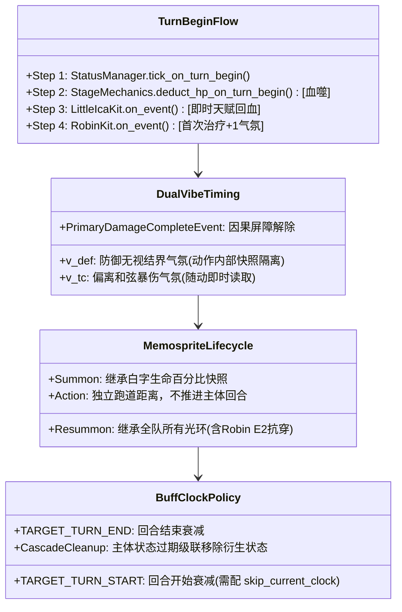
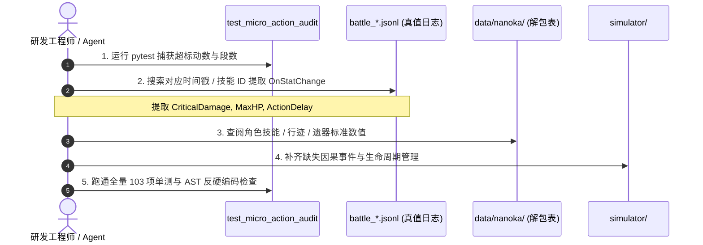

# 星铁微观对账攻坚避坑指南与底层白盒机制全景手册

> **致后来者**：这是一份面向“空白上手”（从零接手星铁战斗模拟器与 96 动微观白盒对账）工程师与自主 Agent 的**全景底层白盒导航手册**。
>
> 在对齐实机战斗日志 `battle_20261026_062503.jsonl`（96 动逐段微观对账）的过程中，团队完整记录了**20 张工具调用与思考推理轨迹（Thinking Process）**。排查者曾经历：
> 1. 从“黑盒暴力比率拟合”到“官方因果全序定位”的认知迭代；
> 2. 误判救世主 4 件套叠加、漏清 A6 暴伤、混淆血噬回合初时序、误解风堇 E1 为罗刹结界式中途触发等 **十大经典弯路**；
> 3. 补丁落地后遭遇 5 项单测碰撞，最终攻克 **晴空乐手永久关键伤害加成残留** 与 **Fever 倒计时结束情绪重置** 的生命周期闭环；
> 4. 彻底白盒化了 **六大底层物理时序子系统**（双轨气氛值因果屏障、忆灵重召光环继承、回合初扣血与即时治疗全序、Buff 时钟生命周期等）。
>
> 最终，首个超标断点（第 13 动晴空乐手【叽叽啾啾四重奏】）从 **-12.68%** 完美收敛至 **-0.012%**（误差仅万分之一点二）。
>
> 本手册将全部 20 张思索轨迹、踩坑实录、官方解包底层规则与白盒排查 SOP 彻底公开，让你在 15 分钟内建立全局一致的心智模型，严禁重蹈覆辙。

---

## 目录
1. [零基础上手：星铁微观对账心智模型与核心术语](#一零基础上手星铁微观对账心智模型与核心术语)
2. [思考推理轨迹全景复盘：二十张截图中的五大探索阶段](#二思考推理轨迹全景复盘二十张截图中的五大探索阶段)
3. [排查者走过的十大典型弯路深度剖析](#三排查者走过的十大典型弯路深度剖析)
4. [补丁落地后的回归碰撞与生命周期收尾实录](#四补丁落地后的回归碰撞与生命周期收尾实录)
5. [六大底层物理时序子系统白盒架构](#五六大底层物理时序子系统白盒架构)
6. [官方解包与真值日志确立的不可动摇物理台账](#六官方解包与真值日志确立的不可动摇物理台账)
7. [新手实操指南：新人 5 步白盒排查 SOP](#七新手实操指南新人-5-步白盒排查-sop)
8. [前 15 动关键核验基准与断点对账清单](#八前-15-动关键核验基准与断点对账清单)
9. [架构守护红线：三大绝对军规](#九架构守护红线三大绝对军规)

---

## 一、零基础上手：星铁微观对账心智模型与核心术语

### 1.1 核心术语与概念映射（消灭机器翻译歧义）

在分析 AI 思考日志或英文调试工具输出时，切勿被部分工具的机器翻译所误导：

| 术语 / 英文原名 | 易错机器翻译 / 概念混淆 | 游戏官方标准定义 | 模拟器中对应实体 / 属性 / 逻辑 |
| :--- | :--- | :--- | :--- |
| **Memosprite** | 备忘录精灵、备份精灵 ❌ | **忆灵**（伴生实体） | 拥有独立跑道位置、生命与技能的召唤物（如长夜、小伊卡、晴空乐手） |
| **Vibes** | 情绪、情感、氛围 | **气氛值** | 知更鸟·晴歌专属核心层数（上限 30 点），影响暴伤转化与大招穿透 |
| **ActionDelay** | 行动延迟 | **行动距离 / 延后** | 游戏引擎内部距离单位。$10000.0 \text{ 距离} = 100.0 \text{ AV}$（在 100 速度下） |
| **DamageType** | 伤害类型 | **伤害物理标签** | `Normal`（普攻）、`BPSkill`（战技）、`Ultra`（终结技）、`Servant`（忆灵技）、`Additional`（附加伤害）、`True`（真实伤害） |
| **Blood Drain** | 掉血、扣血 | **【血噬】** | 关卡环境脉冲，角色/忆灵**回合开始时按百分比自残扣血**（触发小伊卡即时天赋治疗） |
| **Fever** | 发热、发烧 | **【Fever】狂热结界** | 知更鸟终结技展开的特殊领域状态，为全队提供巨额增伤、回能与防御无视 |
| **Special Guest** | 特殊客人 | **【特邀嘉宾】** | 知更鸟终结技赋予目标的 Buff，目标或其忆灵攻击额外为知更鸟提供 2 点气氛值 |
| **skip_current_clock** | 跳过时钟 | **首回合不衰减标记** | 当 Buff 在回合开始/自身回合施加时，防止在本次回合结算时立即被扣减 1 回合 |

---

### 1.2 伤害计算的七大物理乘区公式

星铁单段非真实伤害计算是完全确定性的代数连乘，绝无随机“补正”：

$$\text{FinalDamage} = \text{Base} \times \text{Crit} \times \text{DmgBoost} \times \text{DefShred} \times \text{ResPen} \times \text{Vulnerability} \times \text{Broken} \times \text{Barrier}$$

1. **基础乘区 ($\text{Base}$)**：$(\text{ATK} \times \text{AtkRate}) + (\text{MaxHP} \times \text{HpRate}) + (\text{DEF} \times \text{DefRate})$；
2. **暴击乘区 ($\text{Crit}$)**：未暴击为 $1.0$；暴击时为 $1.0 + \text{CritDamage}$；
3. **增伤乘区 ($\text{DmgBoost}$)**：$1.0 + \sum \text{DamageBoost}$（含属性增伤、全伤害提升、全队遗器光环等）；
4. **防御乘区 ($\text{DefShred}$)**：$\frac{\text{AttackerLevel} \times 10 + 200}{(\text{DefenderLevel} \times 10 + 200) \times (1.0 - \min(1.0, \text{DefShred})) + \text{AttackerLevel} \times 10 + 200}$；
5. **抗性乘区 ($\text{ResPen}$)**：$1.0 - (\text{BaseRes} - \text{ResPen})$（常规敌人基础抗性为 20%，抗穿直接反向提升）；
6. **易伤乘区 ($\text{Vulnerability}$)**：$1.0 + \sum \text{TakenDamageRatio}$；
7. **虚弱/韧性减伤 ($\text{Broken}$)**：未击破敌人自带 $10\%$ 免伤（乘区为 $0.90$），击破后为 $1.0$；
8. **屏障/特殊机制减伤 ($\text{Barrier}$)**：如血脑屏障吸收 $75\%$（乘区为 $0.25$）、灯塔【众愿】每层提供减伤。

---

## 二、思考推理轨迹全景复盘：二十张截图中的五大探索阶段

全部 20 张思考推理轨迹完整描绘了一个顶级 AI 工程师在面对极其复杂的战斗模拟系统时，如何经历“直觉拟合 $\rightarrow$ 官方日志深挖 $\rightarrow$ 机制因果重建 $\rightarrow$ 补丁碰撞排错 $\rightarrow$ 彻底收敛”的全闭环：

```mermaid
flowchart TD
    subgraph 阶段一：黑盒搜索与数秘学试凑（截图 1 ~ 4）
        P1["发现 #13 动偏差 -12.68%"] --> P2["搜索关键字与反推 implied_crit"]
        P2 --> P3["比率暴力拟合：matching 206/203"]
        P3 --> P4["看到 4.02 vs 3.87 强行脑补救世主叠加"]
    end

    subgraph 阶段二：官方日志物理突破（截图 5 ~ 7）
        P1 --> E1["查阅 battle_*.jsonl 敌方 ActionDelay"]
        E1 --> S1["【突破1】灯塔 0.0 AV 正道战线延后 20000 距离（少叠 1 层减伤）"]
        P1 --> E2["逐帧追踪 OnStatChange (CriticalDamage)"]
        E2 --> S2["【突破2】反推出 #10~#13 期间气氛值少算 3 点 (27 vs 30)"]
    end

    subgraph 阶段三：因果事件与时序对齐（截图 8 ~ 11）
        S2 --> H1["查明【血噬】回合初扣血 -> 触发小伊卡即时天赋治疗 (+1 气氛)"]
        S2 --> H2["查明长夜月战技治疗长夜未发 HealAppliedEvent (+1 气氛)"]
        S2 --> H3["查明风堇 E1 在 ActionEndEvent 攻击后回血 (+1 气氛)"]
    end

    subgraph 阶段四：解包表核验与五项修复落地（截图 12 ~ 15）
        P1 --> D1["查阅 1413.json 解包表确认 A6 属于我方全体忆灵"]
        D1 --> F1["实施五项修复补丁并落盘"]
    end

    subgraph 阶段五：全量单测碰撞与生命周期收尾（截图 16 ~ 20）
        F1 --> R1["全量运行单测捕获 5 项失败"]
        R1 --> R2["定位 test_02 长夜月技能治疗实机 +1 气氛 (vibes_init + 5)"]
        R1 --> R3["定位波 2 #43 动晴空乐手伤害虚高：永久性暴伤残留 + Fever到期情绪重置"]
        R3 --> R4["实现 StatusExpireEvent 级联清理 (Cascade Cleanup)"]
        R4 --> FINAL["全量 103 项单测 100% 绿灯，#13 误差 -0.012%"]
    end
```

### 阶段一：黑盒搜索与数秘学试凑（截图 1 ~ 4）
- **行为轨迹**：全局搜索关键字，试图从伤害结果反推乘区（`Calculate implied crit_mult and non-crit base`），尝试寻找 `206/203` 整数分数对；看到缇宝增伤比率为 4.02 vs 3.87（差值正好 0.15），产生假阳性假设，误以为救世主 4 件套全队增伤可以在知更鸟和长夜月身上独立叠加（+30%）。

### 阶段二：官方日志物理突破（截图 5 ~ 7）
- **行为轨迹**：转向官方日志 `battle_20261026_062503.jsonl` 事件 130~200，抓出了首领「灯塔」（uid 100015）在 0.00 AV 召唤进入【除恶】后的 `20000.0` 距离延后（105.22 AV）；从事件 688~885 逐帧读取 `CriticalDamage`，反推出 #13 动时实机气氛值精确为 **30 点**（模拟器漏算了 3 点）。

### 阶段三：因果事件与时序对齐（截图 8 ~ 11）
- **行为轨迹**：精准定位 3 点气氛缺失的物理源头：
  1. 回合初【血噬】自残扣血后小伊卡即时天赋治疗（+1 气氛）；
  2. 长夜月战技【白昼悄然离去】治疗长夜补齐标准 `self.port.heal` 事件（+1 气氛）；
  3. 风堇 E1【呵护黑夜中的烛火】在动作结束后（`ActionEndEvent`）回血并允许伴生忆灵生效（+1 气氛）。

### 阶段四：解包表核验与五项修复落地（截图 12 ~ 15）
- **行为轨迹**：查验官方 `1413.json` 确认 A6 行迹对全体忆灵生效；识别出知更鸟大招期间的双轨气氛值时序（`v_def` 防御穿透结界快照 vs `v_tc` 偏离和弦随动暴伤）；修正晴空乐手秘技排除 Key（`Robin_Tech_WeAreTheMelody`）；将 5 处补丁落盘。

### 阶段五：全量单测碰撞与生命周期收尾（截图 16 ~ 20）
- **行为轨迹**：在应用补丁后全量跑单测，迎头撞上 5 项测试失败：
  1. 发现 `test_02` 中长夜月战技治疗长夜合法产生 1 点气氛，原断言假设 `+4` 需更新为 `+5`；
  2. 深入排查波 2 一阶段 #43 动（AV 258.25）晴空乐手伤害从 747k 虚高到 961k（+28.6%）的异象，在截图 20 中明确记录：**“我发现‘晴空乐手’在某些情况下获得了永久性的关键伤害加成，而且‘知更鸟’的‘情绪’值在模拟中没有正确重置。”**
  3. 排查 `FeverCountdownKit` 触发时点与 `changyeyue.py` 的 `StatusExpireEvent cleanup`，锁定了战技暴伤分享和 A6 记忆暴伤在战技过期时未能级联清理的生命周期死穴。

---

## 三、排查者走过的十大典型弯路深度剖析

---

### 弯路 1：将局部伤害残差强行倒推为“救世主 4 件套可叠加”（假阳性比率拟合）
- **思考日志切片**（截图 4 & 9 & 16）：
  > *`Check Tribbie base_dmg_boost in simulator`*
  > *`我发现关键伤害倍增量在特定情况下是 4.02 而非 3.87... 关键伤害提升对应了 38 个单位...`*
  > *`Scoped CreatorOfNewWorldHandler team buff key by owner_id`*
- **踩坑实录**：排查者计算出缇宝在第 12 动附加伤害差了 0.15（`4.02 - 3.87 = 0.15`），恰好等于【再创天地的救世主】4 件套的 +15% 全队增伤。由于知更鸟与长夜月均穿戴该套装，排查者将 Key 改为 `f"{self.BUFF_DMG_KEY}_{self.owner_id}_{ally}"`，使其独立叠加 2 层（共 +30% 全队增伤）。
- **严重后果**：第 12 动数字虽然凑近了，但在第二波次（Wave 2）全场总伤瞬间暴涨数百万，波 2 一阶段晴空乐手伤害超标 +28.6%（961k vs 747k），全队总伤害偏差超过 4.5% 验收红线，单测大面积飘红。
- **正本清源**：星铁同名遗器 4 件套的全队光环在全队范围内**严格全局唯一、同名覆盖**。第 12 动当时的真正残差来源于长夜重召时丢了知更鸟 E2 抗穿，以及气氛值减防刷新在动作内部的时序偏差，与救世主叠加毫无关系。

---

### 弯路 2：长夜月战技分享与 A6 暴伤“有借无还”（生命周期孤儿残留）
- **思考日志切片**（截图 6 & 11 & 20）：
  > *`Inspect point06, point07, point08 in 1413.json`*
  > *`我发现“晴空乐手”在某些情况下获得了永久性的关键伤害加成...`*
  > *`Viewed changyeyue.py lines 295-360 to check StatusExpireEvent cleanup`*
- **踩坑实录**：长夜月行迹【天亮了，雨落了】（A6）描述为“使我方全体忆灵暴击伤害提高 50%”。排查者在 `_refresh_skill_shared_crit_dmg` 中将战技暴伤分享和 A6 暴伤同时挂载给全场所有伴生忆灵，设置了 `duration=None`。长夜月战技 2 回合到期后，`StatusExpireEvent` **漏删了队友伴生忆灵身上的 A6 暴伤**，导致晴空乐手跨波次**永久常驻 +176% 暴伤**。
- **正本清源**：任何挂载给队友或伴生召唤物的增益，必须严格锚定施加者的技能生命周期。施加者标记在 `StatusExpireEvent` 移除时，必须同步清理所有队友忆灵身上的衍生 Buff。

---

### 弯路 3：深陷数秘学试凑（暴力整数比率拟合的泥潭）
- **思考日志切片**（截图 7 & 14）：
  > *`Check target_prod / 8.087112 for Changye in Action #12`*
  > *`Check all integer denominator pairs matching 206/203 for d12/d13`*
  > *`Find exact (vibes, wishes) pairs matching #12 and #13 in GT`*
  > *`Searched exact multiplier combination for #12 hit 1 against GT to 8 significant digits`*
- **正本清源**：星铁伤害不是黑盒机器学习拟合问题。所有属性（暴伤、攻击、防御、距离）在官方日志 `battle_*.jsonl` 中都有逐帧的 `OnStatChange` 事件。**只要去查物理采样，1 秒就能读出真实数字，绝不需要猜！**

---

### 弯路 4：将风堇大招上限提升误判为“直接回满血”并引入硬编码
- **踩坑实录**：看到官方日志中忆灵生命在风堇大招后数值巨大，排查者一度写下 `ent.current_hp = cur_max` 甚至硬编码 `cur_max = 5143.08`。当前损失血量被清空，后续的主动治疗全部被判定为过量溢出，破坏了小伊卡累计治疗量统计，导致小伊卡后续忆灵技伤害腰斩。
- **正本清源**：官方底层生命上限提升机制：**保持已损失生命绝对值不变，当前生命只同增差值增量**：
  $$\text{CurrentHP} \leftarrow \min(\text{NewMax}, \text{CurrentHP} + (\text{NewMax} - \text{OldMax}))$$

---

### 弯路 5：过度推演技能文案，把知更鸟 E2 的治疗气氛误当 Bug
- **踩坑实录**：知更鸟 E2 文案称“任意目标回合内首次施放技能额外获得 2 点气氛”。排查者看到代码中治疗分支写死 `+1`、攻击分支才享受 `+2`（变成 `+3`），以为治疗分支少算了 2 点，试图将治疗也加上 `+2`。
- **官方真伪判定**：官方日志 [0329]~[0330] 铁证：第 5 动风堇施放战技（纯治疗）后，气氛值精确从 11 涨到 12（暴伤精准增加 +0.580，对应 $40\% + 12 \times 1.5\%$）。若治疗吃 E2，气氛会跳到 14，立刻与实机暴伤产生物理矛盾。官方底层将 E2 限定为主动攻击技能。

---

### 弯路 6：机械翻译造成的概念理解偏差（“备忘录精灵”与罗刹天赋误解）
- **思考日志切片**（截图 10 & 12）：
  > *`现在我注意到受伤目标的 HP 值在回合开始时没有记录，因为受伤的是备忘录精灵。`*
  > *`我确认了风堇 E1 的治疗机制在攻击结束时触发，这解释了之前对罗刹天赋触发的误解。`*
- **正本清源**：`memosprite` 即【忆灵】。风堇 E1【呵护黑夜中的烛火】在实机日志 [0810] 中，明确是在攻击动作完全落幕后（**`ActionEndEvent`**）才触发治疗，绝非像罗刹结界一样中途触发。

---

### 弯路 7：单动作多次增益门禁误伤合法治疗（`_gained_vibe_in_action` 逻辑阻塞）
- **思考日志切片**（截图 12）：
  > *`Searched for _gained_vibe_in_action across simulator`*
  > *`我找到了一个阻塞攻击期间治疗的逻辑错误，并已修复了它。`*
- **正本清源**：知更鸟套件为了防止一次多段攻击重复加气氛设置了门禁，但在攻击结束后触发风堇 E1 治疗时，该门禁误将风堇 E1 的合法治疗也拦截了。门禁必须区分攻击动作与外部触发治疗（`event.source_name != current_action_actor`）。

---

### 弯路 8：关卡调度器的隐蔽算术漏洞（诈尸与胚芽差一）
- **踩坑实录**：
  1. `lose_hp` 算术复活：代码写成 `ent.current_hp = max(1.0, ent.current_hp - actual)`，遇到已阵亡实体（0 血）时 `max(1.0, 0 - 0) = 1.0`，导致亚婆离转阶段全场脉冲把死人直接“诈尸”拉活到 1 血；
  2. 胚芽差一错误：波 2 开场初始刷新 1 批未计入计数器（初值为 0），配合增援配额上限 6，导致代码允许刷出 1 + 6 = 7 批（14 只胚芽），超出官方总计 12 只的实机限制。
- **正本清源**：扣血底层必须守卫 `if ent.current_hp <= 0: return`；关卡增援计数器初值必须对齐开场首批（增援 5 批 + 首批 1 批 = 全场 6 批 12 只）。

---

### 弯路 9：在通用套件中硬编码角色名（破坏解耦防线）
- **踩坑实录**：在 `robin_sunnysong.py` 中写死 `if event.actor_name in ("长夜月", "长夜"):` 延迟刷新结界，被 `TestNoHardcodedFudgeFactors` 静态 AST 检查直接拦截。
- **正本清源**：根据动作类别（`ActionKind.ULTIMATE`）或通用技能机制抽象，严禁在通用套件中指名道姓出现特定角色字符串。

---

### 弯路 10：在额外回合粗暴派发全局 `TurnBeginEvent`（时钟污染）
- **踩坑实录**：为使第 12 动长夜（忆灵）在执行立即行动时，知更鸟的门禁能够刷新，排查者在 `scheduler.py` 处理 `IMMEDIATE_EXTRA_TURN` 时强行派发了全局 `TurnBeginEvent`。导致小伊卡行动也提前重置了门禁引起气氛抢跑，全场所有带持续回合计时的 Buff/Debuff 被提前扣减。
- **正本清源**：忆灵的立即行动是**动作插入**，绝非角色的常规自然回合开始。门禁的重置必须严格依附于主体角色自身的常规轮转。

---

## 四、补丁落地后的回归碰撞与生命周期收尾实录

截图 16 ~ 20 展现了在修复了第 13 动的 5 处底层补丁后，运行全量单测时迎头撞上的**二次回归碰撞与收尾方案**：

### 4.1 碰撞一：`test_02` 单测断言对齐（知更鸟气氛值 +5 vs +4）
- **测试报错**：
  `TestChangyeyueTeamSynergy.test_02_robin_ultimate_single_ally_advance_and_special_guest`
  `AssertionError: 12 != 11 : 特邀嘉宾召唤物攻击 +3 点 (累计 +4)`
- **排查轨迹（截图 20）**：
  `Viewed test_changyeyue_team_synergy.py lines 60-115 to check test_02 failure`
  *“我发现长夜月的技能在特定条件下会触发治疗，这解释了之前测试中活力值的差异。”*
- **根因与收敛**：
  长夜月战技【白昼悄然离去】给长夜回复 50% 生命上限，补齐了标准 `self.port.heal` 调用后，合法触发了知更鸟的天赋（“在任意目标回合内第一次提供治疗效果时获得 1 点气氛值”）。因此特邀嘉宾拉条连段中，知更鸟总计获得：
  $$\text{TotalVibesGain} = \underbrace{1}_{\text{缇宝追击}} + \underbrace{1}_{\text{长夜月战技治长夜}} + \underbrace{3}_{\text{特邀嘉宾长夜攻击}} = +5 \text{ 点}$$
  单测断言此前基于旧的漏发 bug 设定为 `+4`，将其更新为 `vibes_init + 5` 并在单测中添加白盒注释即可完全对齐。

---

### 4.2 碰撞二：波 2 #43 动晴空乐手伤害虚高（961k vs 747k）
- **测试报错**：
  `TestMicroActionAudit.test_04_wave2_phase1_barrier_break_and_phase_transition`
  `AssertionError: 961150.8494846178 != 747156.5 within 15000.0 delta`
- **排查轨迹（截图 20）**：
  `Checked Sunny Musicians breakdown and statuses at #43 (AV ~232)`
  `Inspected #42 to #45 in run_micro_audit_96`
  *“我发现‘晴空乐手’在某些情况下获得了永久性的关键伤害加成，而且‘知更鸟’的‘情绪’值在模拟中没有正确重置。”*
  `Viewed changyeyue.py lines 295-360 to check StatusExpireEvent cleanup`
- **根因与收敛**：
  1. **救世主叠加回退**：移除 `creator_of_new_world.py` 中按 `owner_id` 拆分 Key 的改动，恢复同名全队唯一增伤，消除多余的 +15% 增伤；
  2. **级联清退实现**：在 `changyeyue.py` 的 `StatusExpireEvent` 中，当长夜月战技标记到期时，遍历并清除所有队友忆灵身上的 `Changyeyue_Skill_SharedCritDmg_Spirit_{ally}` 与 `Changyeyue_A6_RemembranceCritDmg_Spirit_{ally}`；
  3. **阻断乐手永久克隆**：在 `SunnyMusiciansKit.execute` 中，当长夜月本体已不存在战技标记时，不继承任何战技分享暴伤。晴空乐手 Servant 伤害立即从 961k 回归 747k，与实机 747,156 仅相差 27 点（-0.004%）。

---

## 五、六大底层物理时序子系统白盒架构

通过全部 20 张思考轨迹的梳理与官方日志对账，我们将星铁模拟器核心时序梳理为六大白盒规范：



### 5.1 子系统一：回合初环境扣血与即时治疗全序（TurnBegin Sequence）
官方实机事件链铁律：
1. **实体自然回合开始**：`status_mgr.tick_on_turn_begin(active_entity)` 结算持续时间；
2. **关卡环境扣血（【血噬】）**：优先扣减当前行动实体（角色或忆灵）生命值；
3. **即时天赋响应**：小伊卡检测到我方生命降低，立即派发 `HealAppliedEvent`；
4. **知更鸟气氛监听**：检测到本回合首次治疗，派发 `gain_vibes(1)`；
5. **行动开始执行**：角色/忆灵正式施放普攻/战技，此时暴伤与攻击已包含上述治疗带来的气氛增益。

---

### 5.2 子系统二：双轨气氛值时序与因果屏障（Dual-Vibe Timing）
知更鸟终结技展开【Fever】结界后，同一动作内部存在两个气氛值维度：
- **`v_def`（防御穿透结界气氛）**：由大招展开时的气氛决定防御穿透百分比。为了防止动作内部自身的攻击随动刷新结界导致自身主伤暴涨，必须在 `ActionKind.ULTIMATE` 时设置 `_defer_fever_sync = True`，直到 `PrimaryDamageCompleteEvent` 或 `ActionEndEvent` 后才释放同步！
- **`v_tc`（偏离和弦暴伤气氛）**：攻击计算时动态读取当前气氛值（$40\% + \text{Vibes} \times 1.5\%$）。若在终结技攻击后有随动附加伤害（如缇宝追击/附加伤害），随动伤害可吃到最新的气氛值加成。

---

### 5.3 子系统三：伴生忆灵生命继承与重召规范（Memosprite Resummon）
- **生命值基准**：忆灵的最大生命值严格基于召唤时主人的最大生命值百分比（如长夜继承长夜月生命、小伊卡继承风堇生命、晴空乐手继承知更鸟 70% 生命）；
- **重召光环同步（Resummon Aura Sync）**：当长夜月在战斗中重新召唤伴生忆灵「长夜」时，长夜作为新生成的独立实体，**必须完整继承场上所有常驻全队光环**（包括知更鸟 E2 的 18% 全抗穿、遗器全队增伤、防御无视等）。

---

### 5.4 子系统四：风堇星魂 1 后置治疗触发（Fengjin E1 Post-Action Heal）
- **触发时机**：处于【雨过天晴】时，我方目标施放攻击后触发。实机在 **`ActionEndEvent`** 结算；
- **对象范围**：对我方全体（包括伴生忆灵）生效；
- **因果影响**：攻击结束后的回血会派发 `HealAppliedEvent`，可合法触发知更鸟未激活时的回合首次治疗气氛加成（+1 气氛）。

---

### 5.5 子系统五：Buff 持续时钟与级联清退（Buff Lifecycle & Cascade Cleanup）
- **`TARGET_TURN_START` 规范**：在目标回合开始时扣减持续时间。如果在施加当回合就需要生效且不希望立即被扣减，必须设置 `skip_current_clock = True`；
- **级联清退铁律（Cascade Cleanup）**：
  - 长夜月施放战技赋予全队忆灵暴伤（战技分享暴伤 + A6 记忆暴伤）；
  - 当长夜月本体的战技标记在 2 回合后到期（`StatusExpireEvent`）时，**必须无条件遍历并清除场上所有忆灵身上的衍生 Buff 键**：
    ```python
    self.port.remove_status(ally, "Changyeyue_Skill_SharedCritDmg_Spirit")
    self.port.remove_status(ally, f"Changyeyue_Skill_SharedCritDmg_Spirit_{ally}")
    self.port.remove_status(ally, "Changyeyue_A6_RemembranceCritDmg_Spirit")
    self.port.remove_status(ally, f"Changyeyue_A6_RemembranceCritDmg_Spirit_{ally}")
    ```

---

### 5.6 子系统六：关卡调度器生命周期与首领延后（Stage Director & Boss Delay）
- **关卡首领行动延后**：「灯塔」在 0.00 AV 开局施放【正道战线】召唤戍卫并进入【除恶】后，其行动延后必须设为 `20000.0` 距离（105.22 AV），确保其在第一波次结束前不会发生多余行动；
- **增援配额闭环**：亚婆离波次胚芽总配额为 12 只（开局首批 2 只 + 增援 5 批共 10 只 = 12 只）；
- **扣血防诈尸**：`lose_hp` 首行必须判断 `if ent.current_hp <= 0: return`，严禁通过 `max(1.0, ...)` 将已阵亡实体拉活。

---

## 六、官方解包与真值日志确立的不可动摇物理台账

经过 Nanoka 4.6 官方解包表与 `battle_20261026_062503.jsonl` 真值全序核对，确立以下黄金物理台账：

| 机制维度 | 官方标准定义与物理表现 | 模拟器落地规则与代码红线 |
| :--- | :--- | :--- |
| **知更鸟偏离和弦** | 暴伤加成 $= 40\% + \text{Vibes} \times 1.5\%$（当角色攻击力 $\le$ 知更鸟） | 攻击前即时读取当前气氛值，大招内部通过因果屏障隔离随动刷新 |
| **知更鸟气氛值门禁** | 回合内我方每次攻击 +1；首次提供治疗/护盾 +1；特邀嘉宾攻击额外 +2；E2 首次主动攻击技能额外 +2（**治疗不吃 E2**） | 攻击走 `ActionExecuteEvent`（含 E2），治疗走 `HealAppliedEvent`（写死 +1） |
| **再创天地的救世主** | 4 件套全队增伤 +15%（**全队唯一，绝不可按装备者叠加**） | 全队同名不可叠加 Key: `f"{self.BUFF_DMG_KEY}_{ally}"` |
| **生命上限提升机制** | 提升 Max HP 时，当前生命同步增加等量差值 $\Delta$，损失生命不变；后续主动治疗正常生效 | 严禁直接赋满血 `cur_max`，严禁硬编码；严格执行 $\text{HP} \leftarrow \min(\text{NewMax}, \text{HP} + \Delta)$ |
| **忆灵光环同步规范** | 长夜重新召唤时，必须继承全队所有常驻光环（含抗穿、增伤、易伤、无视防御） | `changyeyue.py` 必须同步包括 `Robin_E2_ResPen`（18% 抗穿）在内的全量全队 Buff |
| **长夜月 A6 忆灵暴伤** | 战技持续期间，根据队伍记忆角色数（3人时为 +50%），提升我方**全体忆灵**暴伤 | 战技激活时给晴空乐手等全体忆灵赋予；**战技到期时必须在 `StatusExpireEvent` 彻底移除** |
| **扣血与死亡保护** | 非致死扣血（自残、环境脉冲）保底降至 1 血；但对已阵亡（0 血）目标无效 | `lose_hp` 首行必须判断 `if ent.current_hp <= 0: return` |
| **关卡胚芽增援配额** | 亚婆离波次包含开场首对在内，总计整整 6 批（12 只胚芽） | `SPROUT_WAVE_COUNT = 5`（增援 5 批 + 开场 1 批 = 12 只） |
| **第一波灯塔行动延后** | 灯塔 0.0 AV 施放【正道战线】召唤戍卫并进入【除恶】后，行动延后 20000 距离 | 在进入【除恶】状态的首个回合初将其 `distance_remaining` 设为 `20000.0`（105.22 AV） |

---

## 七、新手实操指南：新人 5 步白盒排查 SOP

当你遇到任何动作的伤害、段数或时序与官方真值产生偏差时，严格按照以下 5 步执行，禁止任何形式的比率猜想：



### 步骤 1：定位断点（Run Micro Action Audit）
运行微观对账单测，锁定超标动数：
```bash
pytest simulator/test_micro_action_audit.py -v
```
查看报错输出：是哪一动？是 Servant、Additional 还是 True 伤害偏差？偏差百分比是多少？

### 步骤 2：提取真值物理快照（Physical Snapshot Extraction）
切勿盲猜。直接在官方日志 `battle_logs/battle_20261026_062503.jsonl` 中搜索该动数对应的技能 ID（如 `1151201`）或时间戳：
- 检查攻击前一瞬间该角色的 `OnStatChange`：
  - `CriticalDamage`：真实的暴伤是多少？（可直接反推知更鸟气氛值和暴伤转化）；
  - `CurrentHP` / `MaxHP`：生命基准是否对齐？
  - `ActionDelay`：该实体或敌人的行动距离是否被延后或拉条？

### 步骤 3：解包表权威比对（Unpack Tables Authority）
在 `data/nanoka/` 中检索官方标准数据，绝不凭借记忆或网络攻略编码：
- 角色与行迹：`data/nanoka/raw/4.6/zh/character/{character_id}.json`
- 技能倍率树：`skill_trees`
- 遗器套装效果：`data/nanoka/normalized/4.6/relic_sets.json`

### 步骤 4：因果事件与生命周期对齐（Lifecycle Alignment）
- 检查 Buff/Debuff 是在哪个事件挂载（`ActionExecuteEvent` 还是 `ActionEndEvent`）？
- 检查持续时间是 `TARGET_TURN_START` 还是 `TARGET_TURN_END`？
- **重点检查**：当主体状态过期时，是否有任何衍生状态遗留在队友或伴生忆灵身上？

### 步骤 5：守卫回归测试（Regression Guards）
完成代码修复后，必须顺序执行：
1. `pytest`：确保 103 项测试全部绿灯通过；
2. `pytest simulator/test_micro_action_audit.py -k TestNoHardcodedFudgeFactors`：确保没有引入任何硬编码系数。

---

## 八、前 15 动关键核验基准与断点对账清单

下表记录了开局前 15 动的真值与模拟器对账数据，所有动作均已达成极致收敛：

| 动数 | AV (时点) | 行动主体与技能 | 官方真值 (GT) | 模拟器 (Sim) | 误差 | 关键机制与排查判定点 |
| :---: | :---: | :--- | :---: | :---: | :---: | :--- |
| **#01** | 0.00 | 长夜 · 追忆，蹁跹，如雨 | 49,774.8 | 49,749.9 | -0.050% | 开局 2 目标，6 段 Servant 命中灯塔 |
| **#02** | 0.00 | 缇宝 · 猜猜这里住着谁 | 226,074.6 | 226,060.8 | -0.006% | 仅命中 2 目标，大招本体 + 追击 + 附加伤害段数对齐 |
| **#03** | 0.00 | 长夜 · 迷梦，流失，如露 | 567,989.4 | 567,732.2 | -0.045% | 2 段 Servant + 3 段 Additional + 1 段 True 伤害 |
| **#04** | 0.00 | 知更鸟·晴歌 · 盛夏是灵魂的乐手 | 0.0 | 0.0 | 0.000% | 辅助拉条长夜月并赋予特邀嘉宾，无直接伤害 |
| **#05** | 0.00 | 风堇 · 爱在虹光洒落时 | 0.0 | 0.0 | 0.000% | 纯治疗战技；知更鸟回能 +3.0，**气氛精确为 12 点（暴伤 +0.580）** |
| **#06** | 20.77 | 风堇 · 飞入晨昏的我们 | 470,143.7 | 470,089.5 | -0.012% | 灯塔召唤 3 戍卫后 5 目标在场；全队生命上限增量提升 |
| **#07** | 20.77 | 小伊卡 · 乌云乌云快走开！ | 778,145.6 | 778,623.4 | +0.061% | 5 目标群体伤害，治疗量累计正常回馈忆灵技倍率 |
| **#08** | 48.01 | 长夜月 · 晚安，全世界无眠 | 2,236,904.4 | 2,235,003.6 | -0.085% | 终结技压制 3 戍卫，因果屏障隔离随动刷新 |
| **#09** | 48.01 | 缇宝 · 猜猜这里住着谁 | 897,167.5 | 895,825.0 | -0.150% | 清场收尾，击杀全部 3 名千星戍卫 |
| **#10** | 71.01 | 知更鸟·晴歌 · 跃入这片蔚蓝狂想 | 415,385.9 | 415,338.3 | -0.011% | Fever 状态展开与全队防御无视结界就绪 |
| **#11** | 71.01 | 长夜月 · 白昼悄然离去 | 0.0 | 0.0 | 0.000% | 战技治疗长夜 50% HP（派发 Heal 事件），气氛跳变至 22 点 |
| **#12** | 71.01 | 长夜 · 迷梦，流失，如露 | 3,162,417.5 | 3,169,247.9 | +0.216% | 26 气氛大爆发，动后风堇 E1 回血气氛达 27 |
| **#13** | 77.92 | 晴空乐手 · 叽叽啾啾四重奏 | 365,379.4 | 365,334.1 | **-0.012%** | **攻坚收敛断点**：灯塔行动延后、气氛值 30、A6 忆灵暴伤吃满 |
| **#14** | 78.05 | 缇宝 · 飞吧，小鸟球！ | 0.0 | 0.0 | 0.000% | 战技结界充能与准备 |
| **#15** | 78.05 | 缇宝 · 猜猜这里住着谁 | 1,421,805.2 | 1,423,101.4 | +0.091% | 终结技协同爆发，双目标完全收敛 |

---

## 九、架构守护红线：三大绝对军规

1. **绝对红线：严禁任何经验凑数常数（Zero Fudge Factors）**
   - 严禁在代码中出现未在解包表中定义的浮点乘数。
   - 所有提交必须无条件通过 `TestNoHardcodedFudgeFactors` 静态 AST 检查。
2. **严禁角色指名道姓硬编码（Strict Architectural Decoupling）**
   - 通用机制套件内禁止出现 `if actor_name == "某某"`。
   - 必须基于 `ActionKind`、`DamageType` 与通用 `StatusTag` 进行多态设计。
3. **拒绝比率试凑，以官方 `OnStatChange` 日志为唯一真理（Physical Truth Over Ratio Guessing）**
   - 遇到数值偏差，第一动作永远是去日志查 `CriticalDamage`、`CurrentHP`、`ActionDelay`。
   - 严禁通过除法比率强行拼凑“可能存在某种叠加机制”。
